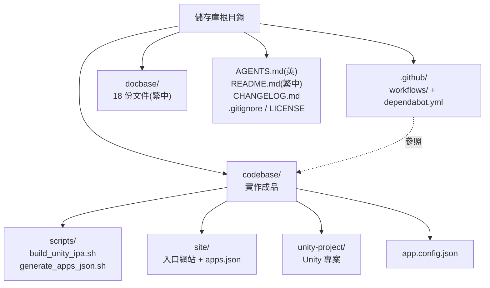

# AGENTS.md

Guidance for OpenCode agents working in this repo. Read before touching CI/CD, build scripts, or docs.

## Repo status

Greenfield app (no Xcode project yet — to be added at repo root), but the **zero-budget iOS CI/CD pipeline for free-Apple-ID sideloading** is fully built. No paid Apple Developer Program, no certificates, no provisioning profiles, no TestFlight. The constraints below define what "correct" looks like.

## Hard constraints

- **No Apple secrets, anywhere.** Only the built-in `GITHUB_TOKEN`. Never introduce `fastlane match`, signing certs, provisioning profiles, or App Store Connect keys. CI must work on a fork with zero extra secrets configured.
- **Every `xcodebuild` invocation is unsigned** — test, build, *and* archive. Pass all four flags each time (easy to drop on one stage):
  `CODE_SIGNING_ALLOWED=NO CODE_SIGNING_REQUIRED=NO CODE_SIGN_IDENTITY="" CODE_SIGN_ENTITLEMENTS=""`
- **macOS runners only** (`macos-latest`). Select Xcode explicitly (`maxim-lobanov/setup-xcode`); don't trust the runner default.
- **Free Apple ID sideload certs expire every 7 days.** This is why the pipeline exists: Releases + the AltStore/SideStore feed let users re-install/refresh without manual re-sideload. Don't bake in any long-lived signing assumption.
- **All user-facing content is in Traditional Chinese (繁體中文).** README, the Pages portal HTML, AltStore/SideStore feed metadata (`codebase/app.config.json` + generated `apps.json`), workflow and step `name:` fields shown in the Actions UI, script comments/logs, and all `docbase/*.md` must be written in Traditional Chinese. Use traditional characters (繁體), not simplified. Keep commands, YAML keys, file paths, identifiers, and product names (AltStore, SideStore, Sideloadly, TestFlight, Xcode, `xcodebuild`, IPA, dSYM, Payload, CodeQL, SwiftLint, Dependabot, `GITHUB_TOKEN`, semver) as-is. `AGENTS.md` itself stays in English as agent guidance. New user-facing strings → Traditional Chinese by default.
- **CHANGELOG is bumped per change.** Every change made via prompt must add a `CHANGELOG.md` entry and bump the semver version (`vX.X.X`) per Keep a Changelog: major for breaking changes, minor for backward-compatible features, patch for fixes. Update the `[Unreleased]` → released section or add a new version section accordingly.
- **No console art / ASCII diagrams.** Never use ASCII box-drawing or monospace art in docs. All diagrams (pipelines, ERDs, flows, wireframes, timelines, sequences) MUST be `mermaid` fenced blocks. Do not keep an "ASCII" version alongside a mermaid version — mermaid is the only rendering. (Plain `bash`/`json`/`text` fences for commands and data are fine — those are not diagrams.)
- **Commit messages in Traditional Chinese.** Both the subject line and body of every git commit must be in Traditional Chinese (繁體中文). Keep Conventional Commits prefixes (`feat:`, `fix:`, `docs:`, `chore:`, etc.) and code/paths/identifiers as-is; the prose around them is zh-Hant. Example: `fix: 修正 scheme 名稱解析的前導空白`.

## Directory layout

- `codebase/` — all implementation artifacts: `converter/`, `scripts/`, `site/`, `unity-project/`, `app.config.json`.
- `.github/workflows/` + `.github/dependabot.yml` — MUST stay at repo root (GitHub hard requirement). They reference `codebase/` paths. Do not move them into `codebase/`.
- `docbase/` — all project documentation (Traditional Chinese): `toctree, charter, srs, pdr, prd, user-stories, adr, architecture, api, uiux, schema, erd, setup, configurations, cicd, rtm, crm, quick-start` (`.md`). `crm` = cross-reference matrix; `rtm` = requirements traceability matrix.
- Root: `AGENTS.md` (English, this file), `README.md` (繁體中文), `CHANGELOG.md` (semver), `.gitignore`, `LICENSE`.
- Build output (`build/`, gitignored) is written at repo root when scripts run from root — not under `codebase/`.

## Workflow (`.github/workflows/cicd.yml`, single file)

One workflow, multiple jobs, one stable stage order. Do not split it back into per-concern files.

**v2.2.18 status:** `test:sast` (Swift/SceneKit job) is **removed** — the original Swift App no longer exists; awaiting Stage C rebuild as a GameCI + Unity pipeline (ADR-010). `build:ipa` runs only on `workflow_dispatch` (downloads a pre-exported Xcode project from a `xcode-export-*` release, then `xcodebuild` archive — no Unity license in CI). `deploy:docs` runs on `push`/`workflow_dispatch` to keep Pages + `apps.json` alive. The bullet list below is the canonical target structure for the rebuild, not the current state.

- `test:sast` — [removed] pending Stage C GameCI rebuild. Original Swift simulator tests + CodeQL Swift analysis deleted (no Swift build target).
- `build:ipa` — [workflow_dispatch only] calls `codebase/scripts/build_unity_ipa.sh` (in `XCODEBUILD_ONLY=1` mode); uploads `unsigned-ipa` (`.ipa` + `manifest.json`) and `dsym`, then uploads assets to the target `release_tag` release.
- `release:ipa` — [merged into `build:ipa`] the build job directly uploads assets to the release.
- `deploy:docs` — `needs: build` with `if: always()` guards (build is `skipped` on non-dispatch events); stages `codebase/site/`, regenerates `apps.json`, deploys via `actions/deploy-pages`. Job-level `concurrency: pages`.
- Triggers: `push` to `main` and `v*` tags, `pull_request`, daily cron, `workflow_dispatch`. `.github/dependabot.yml` covers `github-actions`, weekly.

**Naming convention:** the workflow `name:` must contain **no colon**; every job's `name:` is `stage:artifact` (e.g. `test:sast`, `build:ipa`, `release:ipa`, `deploy:docs`). The colon is display-only — GitHub job **keys** cannot contain `:`, so keep keys plain (`test`, `build`, `release`, `deploy`). New stages must keep both the suffix form and the `test → build → release → deploy` order.

Job-level permissions are minimal: `contents: write` only on `build` (uploads to release), `contents: read` + `actions: read` + `pages: write` + `id-token: write` only on `deploy`. The workflow-level default is `contents: read`.

## Build & package (`codebase/scripts/build_unity_ipa.sh`)

- Three modes (mutually exclusive): default full pipeline (Unity export + `xcodebuild` + package), `UNITY_EXPORT_ONLY=1` (Unity export only, Windows local), `XCODEBUILD_ONLY=1` (`xcodebuild` + package only, CI macOS; requires `XCODE_PROJECT_DIR`).
- Release archive with the unsigned flags: `xcodebuild archive -configuration Release -archivePath build/App.xcarchive ...`.
- Pull `<App>.app` from `App.xcarchive/Products/Applications/` (use `ditto` to preserve symlinks/metadata).
- **IPA layout must be `Payload/<App>.app` at the zip root.** `cd` to the dir containing `Payload/` and `zip -r "<App>-<Ver>.ipa" Payload` — zipping the bare `.app` or zipping from *inside* `Payload/` produces a file AltStore/Sideloadly reject.
- Derive `<App>` and `<Ver>` from the built `Info.plist` (`CFBundleShortVersionString` / `CFBundleIdentifier`); don't hardcode.
- Package dSYMs from `App.xcarchive/dSYMs/` as `<App>-<Ver>.dSYM.zip`.
- Scheme detection: read `.xcscheme` filename directly from `xcshareddata/xcschemes/` (Tuanjie exports `Tuanjie-iPhone`, Unity exports `Unity-iPhone`); fallback to `xcodebuild -list`; final fallback to `.xcodeproj` basename.
- Emit `manifest.json` (asset-sourced `{appName, bundleIdentifier, version, ipaFileName, dsymFileName, ipaSizeBytes, minIOSVersion}`) and write `GITHUB_OUTPUT` keys.
- Verify locally: `unzip -l "<App>-<Ver>.ipa"` must list `Payload/<App>.app/...` at the root.
- iOS shader stripping is the recurring root cause of blue-screen errors. `BuildIOS.cs`'s `EnsureGltfFastShadersIncluded()` adds glTFast + `Standard` shaders to GraphicsSettings Always Included Shaders (via SerializedObject on `GraphicsSettings.asset`). `link.xml` preserves C# assemblies but NOT shader assets.

## App (`codebase/unity-project/`)

- Native **Tuanjie 2022.3.61t15 + C# + glTFast** photogrammetry flythrough (see `docbase/adr.md` ADR-009, which supersedes the Swift/SceneKit ADR-007). Renders real CSDI `.osgb` photogrammetry, converted to chunked `.glb` by Stage A (`codebase/converter/`), streamed at runtime by Stage B.
- **Three-stage pipeline:**
  - **Stage A** (`codebase/converter/`): Python, Unity-agnostic. `convert_osgb_to_chunks.py` runs `osgconv` → `trimesh` (recenter + texture downscale + GLB export). `decimate_glb.py` re-simplifies existing chunks: default flat-color mode (`fast_simplification`) or `--textured` mode (`fast_simplification` + scipy KDTree UV reprojection + texture downscale — preserves textures, no pymeshlab needed). `validate_chunks.py` is the hard size gate (≤ 10 MB/chunk, ≤ 200 MB total). Each CSDI sub-tile (`Tile_+X_+Y`) = one `.glb` chunk. Output `manifest.json` lists chunk id/bbox/centroid/file/bytes/triangles/neighbors.
  - **Stage B** (`codebase/unity-project/Assets/Scripts/`): runtime chunk streamer using `com.unity.cloud.gltfast` (`GltfImport` + `InstantiateMainSceneAsync` + `Dispose()`), `TimeBudgetPerFrameDeferAgent` for frame-budgeted loading, spatial load/unload by camera radius, HK coordinates (EPSG:2326 Z-up) normalized to local origin with −90° X rotation to Y-up.
  - **Stage C**: iOS Player Settings → Xcode export (local Windows via `export_xcode_project.ps1`) → CI macOS `xcodebuild` unsigned archive → `.ipa`. No Unity license in CI.
- Scripts: `ChunkManifest.cs` (manifest.json data model), `ChunkStreamConfig.cs` (ScriptableObject settings), `ChunkStreamer.cs` (core streamer), `ChunkStreamBootstrapper.cs` (scene entry + legacy ground fill (disabled) + defensive shader fallback), `TouchPlayerController.cs` (touch controls: hidden joystick pan/tilt + right-drag look + pinch zoom + double-tap-right-to-jump; desktop WASD/mouse), `DebugOverlay.cs` (on-screen diagnostics).
- Chunk data lives in `Assets/StreamingAssets/Chunks/` (manifest.json + `.glb` files); it is a build artifact regenerated by Stage A, gitignored, not committed. Injected at Xcode export time via `export_xcode_project.ps1 -ChunksSource`.
- **Status (v2.2.18):** Stage A complete + verified on real 11-NW-15B (Kowloon City District) data — 1.8 GB OSGB → 22.5 MB textured GLB (20 chunks, all preserved). Stage B operational — IPA renders chunks on iPhone with textures. Stage C operational — local Windows Tuanjie export + CI macOS `xcodebuild` (workflow_dispatch only). `test:sast` removed pending GameCI rebuild.
- **Ground-quality reference (good example):** the l18 set `11-NW-15B_chunks_unity_800mb` (204.64 MB, 20 chunks, 1,686,450 tris, full-res textures, `--no-floating-removal`) is the canonical "smooth ground, no holes" reference for Kowloon City (11-NW-15B). Its ground is seamless across the whole 5×4 grid — no intra-grid holes, no double planes. Future high-detail conversions of this district MUST match its ground quality. Re-export it from the OSGB extract with `--lod l18 --max-texture-px 99999 --max-chunk-mb 99999 --max-total-mb 99999 --decimate-threshold 999999999 --no-floating-removal`.
- **⚠ Floating-ground removal vs high LOD (root cause of ground holes):** `convert_osgb_to_chunks.py`'s floating-ground removal (default ON) removes horizontal faces 3–20 m above the local KDTree min-Z. At l16/l17 density this cleanly de-layers the "4 islands" artefact. At l18+/l19+ density it **over-removes legitimate surfaces (terraces, low roofs, raised plazas) → ground holes**. The script itself warns (v2.2.2 note):「可能過度移除合法表面…造成地面大洞」. **Rule: for l18 and deeper (l18/l19/l20…), ALWAYS pass `--no-floating-removal`.** Keeping the floating layers is visually harmless at high density (layers sit close together, read as one smooth surface) and the alternative (holes) is far worse. Do NOT re-enable floating-removal for high-LOD conversions without re-validating ground continuity.
- **Ground system (v2.6.3): real mesh colliders are the preferred ground — use first.** `ChunkStreamConfig.addChunkColliders=true` + `groundFillEnabled=false` is the correct default. The real photogrammetry mesh (`MeshCollider` per chunk via `ChunkStreamer.AddCollidersRecursive`) IS the ground — roads, terrain, building bases. The player stands on actual geometry, and `CharacterController` also blocks horizontal movement into buildings. The ground-follow ray in `TouchPlayerController` (2 m above player, 250 m down) hits the real mesh directly. **GroundFill (`ChunkStreamBootstrapper.CreateChunkFill`) is legacy and disabled** — it was a flawed approximation that caused three confirmed bugs: (1) 8×8 grid vertex inset → ~18 m voids between adjacent chunks → fall-through at chunk boundaries and spawn; (2) building-vertex contamination (min-Y per cell picked roof heights; GROUND_BAND=40 m filter insufficient for ≤40 m buildings) → "pseudo-ground" at wrong heights; (3) visible olive-green planes ("pseudo-ground materials"). Do NOT re-enable GroundFill (`groundFillEnabled`) without re-validating all three symptoms. If ground holes appear, fix Stage A (`--no-floating-removal` for l18+) rather than papering over with GroundFill. The legacy GroundFill code is retained (dead when disabled) for reversibility.

## Testing

- **No active test job.** The original Swift simulator tests + CodeQL Swift analysis are removed (`test:sast` job deleted — no Swift build target). Unity tests pending Stage C GameCI rebuild (ADR-010).
- When restored: simulator destinations only (no signing), e.g. `-destination 'platform=iOS Simulator,name=iPhone 15,OS=latest'`. UI tests need a booted simulator.
- Coverage: `-enableCodeCoverage YES`; export reports from the `.xcresult` via `xcrun xccov view --report --json <path.xcresult>`.

## Pages + AltStore/SideStore feed

- Deploy with the modern flow: `permissions: { pages: write, id-token: write }`, `environment: github-pages`, `actions/upload-pages-artifact` → `actions/deploy-pages`. Repo Pages setting must be **Source: GitHub Actions**, not a branch.
- Serve `apps.json` at the site root → source URL `https://mcc-mak.github.io/ios-app/apps.json`.
- Regenerate `apps.json` on every deploy via `codebase/scripts/generate_apps_json.sh` (called by the `deploy:docs` job). Per-app entry, at minimum: `name`, `bundleIdentifier`, `version`, `versionDate` (ISO 8601), `downloadURL`, `size` (bytes). `version` / `versionDate` / `size` / `downloadURL` MUST come from the **actual release asset** (+ `manifest.json`), not be guessed. `downloadURL` = `https://github.com/<owner>/<repo>/releases/download/<tag>/<App>-<Ver>.ipa`. Feed-level metadata comes from `codebase/app.config.json`. If no `v*` release exists the feed is legitimately `apps: []`.
- **Releases, not artifacts, drive the feed.** A CI artifact never appears in `apps.json`; if no `v*` release exists the feed is legitimately `apps: []`. Never "fix" that by guessing a version — publish a tag.
- The landing page (`codebase/site/index.html`) is the single user-facing home for **all** deployment methods and their step-by-step procedures (IPA download, AltStore/SideStore source, Sideloadly, Xcode, Actions artifacts) plus the 7-day expiry FAQ. When a method changes, update the site; `README.md` is the long-form mirror.
- The site must never dead-end on a disabled button: when `apps.json` is empty or unreachable, the download button falls back to `https://github.com/<owner>/<repo>/releases/latest` and explains that releases (not artifacts) populate the feed.

## Conventions

- Semver release tags: `v1.2.3`; releases are created by the `build:ipa` job (workflow_dispatch with `release_tag` input) or manually.
- Reuse `codebase/scripts/build_unity_ipa.sh` from workflows rather than re-running `xcodebuild` inline. The CI calls it in `XCODEBUILD_ONLY=1` mode against the pre-exported Xcode project.
- `build:ipa` is NOT auto-run on push — `if: github.event_name == 'workflow_dispatch'` only. It requires a pre-uploaded `xcode-export-*` release containing the Xcode project tarball.
- Commit messages in Traditional Chinese (繁體中文); keep Conventional Commits prefixes (`feat:`, `fix:`, `docs:`, `chore:`) and code/paths/identifiers as-is.

## References

- `README.md` — sideloading + how-to-add-`apps.json` section (Traditional Chinese).
- `CHANGELOG.md` — semver changelog; bump per change.
- `docbase/` — full project documentation (Traditional Chinese). Start at `docbase/toctree.md`.
