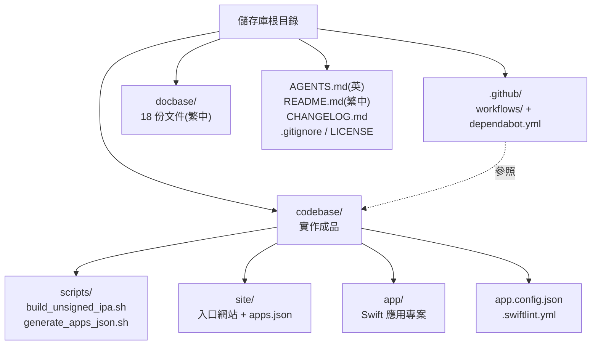

# AGENTS.md

Guidance for OpenCode agents working in this repo. Read before touching CI/CD, build scripts, or docs.

## Repo status

Greenfield app (no Xcode project yet — to be added at repo root), but the **zero-budget iOS CI/CD pipeline for free-Apple-ID sideloading** is fully built. No paid Apple Developer Program, no certificates, no provisioning profiles, no TestFlight. The constraints below define what "correct" looks like.

## Hard constraints

- **No Apple secrets, anywhere.** Only the built-in `GITHUB_TOKEN`. Never introduce `fastlane match`, signing certs, provisioning profiles, or App Store Connect keys. CI must work on a fork with zero extra secrets configured.
- **Every `xcodebuild` invocation is unsigned** — test, build, *and* archive. Pass all four flags each time (easy to drop on one stage):
  `CODE_SIGNING_ALLOWED=NO CODE_SIGNING_REQUIRED=NO CODE_SIGN_IDENTITY="" CODE_SIGN_ENTITLEMENTS=""`
- **macOS runners only** (`macos-latest`). Select Xcode explicitly (`maxim-lobanov/setup-xcode`); don't trust the runner default.
- **Free Apple ID sideload certs expire every 7 days.** This is why the pipeline exists: Releases + the AltStore/SideStore feed let users re-install/refresh without manual re-sideload. Don't bake in any long-lived signing assumption.
- **All user-facing content is in Traditional Chinese (繁體中文).** README, the Pages portal HTML, AltStore/SideStore feed metadata (`codebase/app.config.json` + generated `apps.json`), workflow and step `name:` fields shown in the Actions UI, script comments/logs, and all `docbase/*.md` must be written in Traditional Chinese. Use traditional characters (繁體), not simplified. Keep commands, YAML keys, file paths, identifiers, and product names (AltStore, SideStore, Sideloadly, TestFlight, Xcode, `xcodebuild`, IPA, dSYM, Payload, CodeQL, SwiftLint, Dependabot, `GITHUB_TOKEN`, semver) as-is. `AGENTS.md` itself stays in English as agent guidance. New user-facing strings → Traditional Chinese by default.
- **CHANGELOG is bumped per change.** Every change made via prompt must add a `CHANGELOG.md` entry and bump the semver version (`vX.X.X`) per Keep a Changelog: major for breaking changes, minor for backward-compatible features, patch for fixes. Update the `[Unreleased]` → released section or add a new version section accordingly.
- **No console art / ASCII diagrams.** Never use ASCII box-drawing or monospace art in docs. All diagrams (pipelines, ERDs, flows, wireframes, timelines, sequences) MUST be `mermaid` fenced blocks. Do not keep an "ASCII" version alongside a mermaid version — mermaid is the only rendering. (Plain `bash`/`json`/`text` fences for commands and data are fine — those are not diagrams.)
- **Commit messages in Traditional Chinese.** Both the subject line and body of every git commit must be in Traditional Chinese (繁體中文). Keep Conventional Commits prefixes (`feat:`, `fix:`, `docs:`, `chore:`, etc.) and code/paths/identifiers as-is; the prose around them is zh-Hant. Example: `fix: 修正 scheme 名稱解析的前導空白`.

## Directory layout

- `codebase/` — all implementation artifacts: `scripts/`, `site/`, `app/`, `app.config.json`, `.swiftlint.yml`.
- `.github/workflows/` + `.github/dependabot.yml` — MUST stay at repo root (GitHub hard requirement). They reference `codebase/` paths. Do not move them into `codebase/`.
- `docbase/` — all project documentation (Traditional Chinese): `toctree, charter, srs, pdr, prd, user-stories, adr, architecture, api, uiux, schema, erd, setup, configurations, cicd, rtm, crm, quick-start` (`.md`). `crm` = cross-reference matrix; `rtm` = requirements traceability matrix.
- Root: `AGENTS.md` (English, this file), `README.md` (繁體中文), `CHANGELOG.md` (semver), `.gitignore`, `LICENSE`.
- Build output (`build/`, gitignored) is written at repo root when scripts run from root — not under `codebase/`.

## Workflows (`.github/workflows/`, one concern each)

- `ci.yml` — Test (simulator) + Build unsigned IPA + upload artifacts. On push/PR to `main`. Calls `codebase/scripts/build_unsigned_ipa.sh`.
- `release.yml` — Create GitHub Release on `v*` semver tags; attach `.ipa` + `.dSYM` + `manifest.json`; then triggers `pages.yml`.
- `pages.yml` — Stage `codebase/site/`, regenerate `apps.json`, deploy via `actions/deploy-pages`.
- `codeql.yml` (Swift; `build-mode: manual` — runs the unsigned build first so CodeQL can instrument compile), `health.yml` (daily cron build on `main`), `.github/dependabot.yml` (`swift` + `github-actions`, weekly).

## Build & package (`codebase/scripts/build_unsigned_ipa.sh`)

- Release archive with the unsigned flags: `xcodebuild archive -configuration Release -archivePath build/App.xcarchive ...`.
- Pull `<App>.app` from `App.xcarchive/Products/Applications/` (use `ditto` to preserve symlinks/metadata).
- **IPA layout must be `Payload/<App>.app` at the zip root.** `cd` to the dir containing `Payload/` and `zip -r "<App>-<Ver>.ipa" Payload` — zipping the bare `.app` or zipping from *inside* `Payload/` produces a file AltStore/Sideloadly reject.
- Derive `<App>` and `<Ver>` from the built `Info.plist` (`CFBundleName` / `CFBundleShortVersionString`); don't hardcode.
- Package dSYMs from `App.xcarchive/dSYMs/` as `<App>-<Ver>.dSYM.zip`.
- Auto-discover `.xcodeproj`/`.xcworkspace` + scheme (maxdepth 4 so projects at root or under `codebase/` are found); **fail fast if more than one** is found rather than guessing.
- Emit `manifest.json` (asset-sourced `{appName, bundleIdentifier, version, ipaFileName, dsymFileName}`) and write `GITHUB_OUTPUT` keys.
- Verify locally: `unzip -l "<App>-<Ver>.ipa"` must list `Payload/<App>.app/...` at the root.

## App (`codebase/app/HKMinecraftVoxel.xcodeproj`)

- Native **Swift + SceneKit + Metal** voxel HK-terrain flythrough (NOT Unity/Cesium — see `docbase/adr.md` ADR-007). Chosen because Unity iOS builds need a Unity license secret and Cesium needs an ion token, both violating the zero-secrets constraint; the maintainer cannot provide a Unity license and won't install Unity locally.
- `TerrainDataSource` protocol is the pluggable height-source seam. `ProceduralHKTerrain` (deterministic, offline, 6 HK peaks) is the default; `CSDIDEMTerrain` is the documented extension point for real HK CSDI open-data DEM (no ion token).
- Sources: `HKMinecraftApp.swift` (@main), `ContentView.swift`, `TerrainDataSource.swift`, `VoxelMeshBuilder.swift` (single merged `SCNGeometry`, per-vertex biome colors), `VoxelSceneFactory.swift` (sky/light/fog), `FlyCameraController.swift` (CADisplayLink orbit + HUD).
- Tests: `HKMinecraftVoxelTests/TerrainDataSourceTests.swift` (determinism, sea-level clamp, known peaks). Shared scheme `HKMinecraftVoxel` is committed so `xcodebuild -list` finds it.
- Bundle ID `com.mccmak.hkminecraftvoxel`, deployment target iOS 16, `zh-Hant`. Unsigned flags baked into both target + project build configs.
- The hand-written `project.pbxproj` uses fixed `A1…` UUIDs; when adding files, follow the existing UUID pattern and keep braces balanced.

## Testing

- Simulator destinations only (no signing), e.g. `-destination 'platform=iOS Simulator,name=iPhone 15,OS=latest'`. UI tests need a booted simulator.
- Coverage: `-enableCodeCoverage YES`; export reports from the `.xcresult` via `xcrun xccov view --report --json <path.xcresult>`.

## Pages + AltStore/SideStore feed

- Deploy with the modern flow: `permissions: { pages: write, id-token: write }`, `environment: github-pages`, `actions/upload-pages-artifact` → `actions/deploy-pages`. Repo Pages setting must be **Source: GitHub Actions**, not a branch.
- Serve `apps.json` at the site root → source URL `https://mcc-mak.github.io/ios-app/apps.json`.
- Regenerate `apps.json` on every release via `codebase/scripts/generate_apps_json.sh` (called by `pages.yml`, which `release.yml` triggers). Per-app entry, at minimum: `name`, `bundleIdentifier`, `version`, `versionDate` (ISO 8601), `downloadURL`, `size` (bytes). `version` / `versionDate` / `size` / `downloadURL` MUST come from the **actual release asset** (+ `manifest.json`), not be guessed. `downloadURL` = `https://github.com/<owner>/<repo>/releases/download/<tag>/<App>-<Ver>.ipa`. Feed-level metadata comes from `codebase/app.config.json`.
- The landing page (`codebase/site/index.html`) links the latest `.ipa` and points to README for sideloading steps (single source) — don't duplicate in the site beyond short links.

## Conventions

- Semver release tags: `v1.2.3`; `release.yml` on `push: tags: ['v*']`.
- Reuse `codebase/scripts/build_unsigned_ipa.sh` from workflows rather than re-running `xcodebuild` inline.
- SwiftLint config at `codebase/.swiftlint.yml`; invoke with `--config codebase/.swiftlint.yml` when linting. CodeQL Swift analysis requires the unsigned build to succeed first.

## References

- `README.md` — sideloading + how-to-add-`apps.json` section (Traditional Chinese).
- `CHANGELOG.md` — semver changelog; bump per change.
- `docbase/` — full project documentation (Traditional Chinese). Start at `docbase/toctree.md`.
