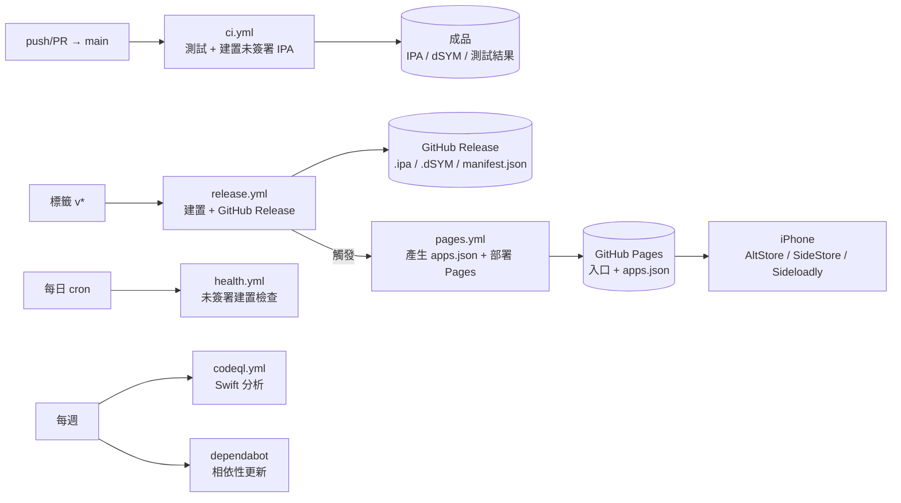

# ios-app

**香港體素飛覽 App(HK Minecraft)** —— 以 SceneKit + Metal 在 iPhone 上以 Minecraft 體素風格
呈現香港地形(太平山、大帽山、鳳凰山等),地形資料來源可插拔(程序化或 HK CSDI 開放資料 DEM)。
以**免費 Apple ID 側載**方式散布 —— 無需付費 Apple 開發者計畫、無需憑證、無需描述檔、無需 TestFlight。
版本由零成本 GitHub Actions 管線建置,並以 GitHub Release 與 GitHub Pages 上的 AltStore/SideStore
來源饋流發布。

> 狀態:管線與 App 皆已建置完成;Xcode 專案位於 `codebase/app/HKMinecraftVoxel.xcodeproj`,
> 由 `build_unsigned_ipa.sh` 自動探索。詳見 [儲存庫結構](#儲存庫結構)。

---

## 管線運作方式



| 階段 | 工作流程 | 觸發條件 | 產出 |
| --- | --- | --- | --- |
| 1. 測試 | [`ci.yml`](.github/workflows/ci.yml) | push/PR 至 `main` | 模擬器單元 + UI 測試、覆蓋率報告 |
| 2. 建置(未簽署 IPA) | [`ci.yml`](.github/workflows/ci.yml) | push/PR 至 `main` | `<App>-<Ver>.ipa`、`manifest.json` |
| 3. 上傳成品 | [`ci.yml`](.github/workflows/ci.yml) | (同上) | `unsigned-ipa`、`dsym`、`test-results` 成品 |
| 4. 發行版本 | [`release.yml`](.github/workflows/release.yml) | 標籤 `v*` | GitHub Release(附 `.ipa` + `.dSYM` + `manifest.json`) |
| 5. Pages 入口與饋流 | [`pages.yml`](.github/workflows/pages.yml) | 網站/設定變更,或發行版本後 | 入口網站 + 自動更新的 `apps.json` |
| 6. 監控 | [`codeql.yml`](.github/workflows/codeql.yml)、[`health.yml`](.github/workflows/health.yml)、[`dependabot.yml`](.github/dependabot.yml) | 排程 / push | CodeQL 掃描、每日建置檢查、相依性 PR |

所有工作流程僅使用內建 `GITHUB_TOKEN` —— **零 Apple 機密**需設定。每次 `xcodebuild`
皆以 `CODE_SIGNING_ALLOWED=NO CODE_SIGNING_REQUIRED=NO CODE_SIGN_IDENTITY="" CODE_SIGN_ENTITLEMENTS=""` 執行。

### 建置與打包邏輯

[`codebase/scripts/build_unsigned_ipa.sh`](codebase/scripts/build_unsigned_ipa.sh) 會
自動探索 `.xcodeproj`/`.xcworkspace` 與 scheme(找到多個則立即失敗),以 Release 模式
未簽署封存,並打包成正確的 IPA(`Payload/<App>.app` 位於 zip 根目錄)。App 名稱與版本
讀取自已建置的 `Info.plist`(`CFBundleName` / `CFBundleShortVersionString`)—— 絕不寫死。
同時產出 `manifest.json`(饋流用的資產來源中繼資料)與 `.dSYM.zip`。

[`codebase/scripts/generate_apps_json.sh`](codebase/scripts/generate_apps_json.sh) 從
最新 GitHub Release 重建 AltStore/SideStore `apps.json`。`version`、`versionDate`、
`size`、`downloadURL` 來自實際發行資產 + `manifest.json`;饋流中繼資料(來源名稱、描述、
網站)來自 [`codebase/app.config.json`](codebase/app.config.json)。

---

## 如何觸發建置

- **CI(測試 + 未簽署 IPA):** push 至 `main` 或開 PR。成品會出現在工作流程執行的
  「Artifacts」區,供立即驗證。
- **發行版本:** push 語意化版本標籤 —— `git tag v1.2.3 && git push origin v1.2.3`。
  `release.yml` 會建置 IPA、建立附說明 + `.ipa` + `.dSYM` 的 GitHub Release,再觸發
  `pages.yml` 更新 `apps.json`。
- **Pages(入口與饋流):** 任何觸及 `codebase/site/`、`codebase/app.config.json` 或
  產生器腳本的 push 會自動重新部署。每次發行版本後也會重新執行。
- **手動:** 每個工作流程都有「Run workflow」按鈕(`workflow_dispatch`)。

### 一次性儲存庫設定

1. **Pages 來源:** Settings → Pages → *Build and deployment* →
   **Source: GitHub Actions**(非分支)。否則 `pages.yml` 部署會失敗。
2. **工作流程權限:** Settings → Actions → General → *Workflow permissions* →
   **Read and write**(讓 `release.yml` 能建立發行版本並觸發 `pages.yml`)。權杖仍為
   儲存庫範圍且免費。
3. **加入 Xcode 專案**至儲存庫根目錄。標記第一個發行版本(`v0.1.0`)即可發布。

---

## 在 iPhone 上安裝

擇一方式。所有方式皆使用**免費 Apple ID** 並安裝你掌控的未簽署 IPA。參見
[7 天更新週期](#7-天免費-apple-id-憑證更新週期)。

### 透過 Sideloadly 側載

1. 從[發行版本頁面](https://github.com/Mcc-Mak/ios-app/releases)或
   [入口網站](https://mcc-mak.github.io/ios-app/)下載最新 `.ipa`。
2. 在 Mac/PC 安裝 [Sideloadly](https://sideloadly.io/)。
3. 以 USB 連接 iPhone,開啟 Sideloadly,輸入你的**免費 Apple ID**。
4. 拖入 `.ipa` 並點擊 **Start**。在裝置上核准開發者描述檔:設定 → 一般 →
   VPN 與裝置管理 → 信任你的 Apple ID。
5. App 已安裝。7 天內需重新側載以維持可用。

### 加入 AltStore/SideStore

1. 安裝 [AltStore](https://altstore.io/)(需 Mac/PC 配套應用)或
   [SideStore](https://sidestore.io/)(無線,設定後不需配套 PC)。
2. 加入來源饍流:**設定 → 來源 → 點擊「+」→ 貼上:**

   ```
   https://mcc-mak.github.io/ios-app/apps.json
   ```

3. App 會出現在來源下。點擊 **Install**,再點 **Refresh**(於裝置上使用免費 Apple ID)。
4. AltStore/SideStore 在背景執行時會自動更新 7 天憑證(AltStore 需與配套應用同一 Wi-Fi;
   SideStore 透過裝置端 ani-sidegrade)。

### 7 天免費 Apple ID 憑證更新週期

免費 Apple ID 簽署憑證有效期為 **7 天**。到期後 App 會無法開啟,直到重新簽署。無付費
帳號則無法繞過此限制。

- **AltStore/SideStore:** 在 7 天到期前更新 App(手動或背景自動)—— 即以新憑證重新簽署。
- **Sideloadly:** 7 天內重新執行側載步驟。
- 管線的 Release + `apps.json` 饋流存在,是為了讓你隨時能取得最新 `.ipa` 重新側載/更新 ——
  無需手動處理檔案,CI 中也無任何長期簽署假設。

每台裝置最多 **3 個 App**,每個免費 Apple ID 每 7 天最多 **10 個 App ID**。

---

## 儲存庫結構

```
.github/
  workflows/        ci、release、pages、codeql、health
  dependabot.yml    swift + github-actions 相依性更新
codebase/           所有實作成品
  scripts/
    build_unsigned_ipa.sh   確定性未簽署建置 + IPA 打包
    generate_apps_json.sh   從最新發行版本產生 AltStore/SideStore 饋流
  site/             靜態 Pages 入口網站(index.html、style.css、apps.json)
  app.config.json   饋流層級中繼資料(名稱、bundle ID、描述…)
  .swiftlint.yml    SwiftLint 設定
docbase/            專案文件(繁體中文)
AGENTS.md           OpenCode 代理人指引
CHANGELOG.md        語意化版本變更記錄
README.md
```

`.github/workflows/` 與 `.github/dependabot.yml` 必須留在儲存庫根目錄(GitHub 的硬性
要求),但會參照 `codebase/` 下的腳本與網站。Xcode 專案(`.xcodeproj`)加入後置於
儲存庫根目錄。

---

## 授權

[MIT](LICENSE) © 2026 Mcc-Mak
