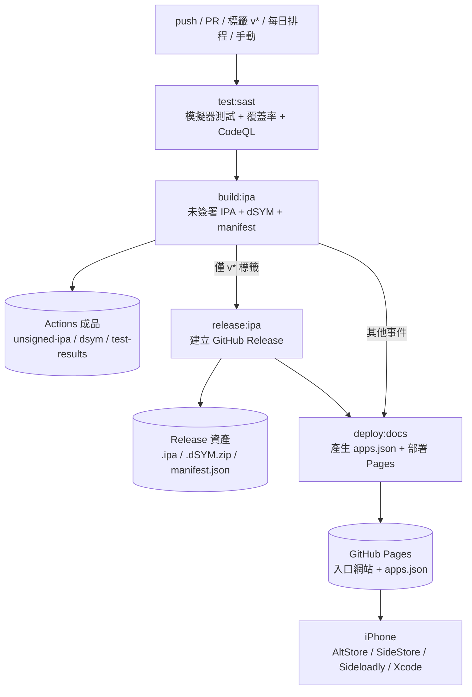

# ios-app

**香港體素飛覽 App(HK Minecraft)** —— 以 SceneKit + Metal 在 iPhone 上呈現香港地形,
支援兩種場景模式:(1) Minecraft 體素風格的程序化香港山脊(太平山、大帽山、鳳凰山等),
(2) **旺角實景** —— 直接載入香港地政總署 CSDI 開放資料的真實 3D 網格(非程序化、非猜測),
攝影機以 300 m AGL 貼地巡航。地形資料來源可插拔。
以**免費 Apple ID 側載**方式散布 —— 無需付費 Apple 開發者計畫、無需憑證、無需描述檔、無需 TestFlight。
版本由零成本 GitHub Actions 管線建置,並以 GitHub Release 與 GitHub Pages 上的 AltStore/SideStore
來源饋流發布。

> 狀態:管線與 App 皆已建置完成;Xcode 專案位於 `codebase/app/HKMinecraftVoxel.xcodeproj`,
> 由 `build_unsigned_ipa.sh` 自動探索。詳見 [儲存庫結構](#儲存庫結構)。

> **資料來源標註:** 旺角實景場景使用香港特別行政區地政總署(Lands Department)
> 「3D 視覺化地圖(圖幅式模型)」開放資料,圖幅 `11-NW-19B`。資料以開放授權提供,
> 使用時須標註「© 香港特別行政區地政總署 / Government of the Hong Kong SAR」。

---

## 管線運作方式

單一工作流程 [`cicd.yml`](.github/workflows/cicd.yml),四個 job 依序執行;
job 顯示名稱固定為「階段:產物」,工作流程名稱不含冒號。



| 階段 | Job | 觸發條件 | 產出 |
| --- | --- | --- | --- |
| 1. 測試 + SAST | [`test:sast`](.github/workflows/cicd.yml) | 全部觸發(push / PR / 標籤 / 排程 / 手動) | 模擬器單元 + UI 測試、覆蓋率、CodeQL Swift 分析 |
| 2. 建置(未簽署 IPA) | [`build:ipa`](.github/workflows/cicd.yml) | 接續 `test:sast` 成功後 | `<App>-<Ver>.ipa`、`manifest.json`、`.dSYM.zip` |
| 3. 上傳成品 | [`build:ipa`](.github/workflows/cicd.yml) | 同上 | Actions 成品:`unsigned-ipa`、`dsym`、`test-results` |
| 4. 發行版本 | [`release:ipa`](.github/workflows/cicd.yml) | 標籤 `v*` | GitHub Release(附 `.ipa` + `.dSYM.zip` + `manifest.json`) |
| 5. Pages 入口與饋流 | [`deploy:docs`](.github/workflows/cicd.yml) | push 至 `main`、標籤發行後、手動 | 入口網站 + 自動更新的 `apps.json` |
| 6. 監控 | 每日排程 + [`dependabot.yml`](.github/dependabot.yml) | 排程 / 每週 | 未簽署建置健康檢查、相依性 PR |

所有 job 僅使用內建 `GITHUB_TOKEN` —— **零 Apple 機密**需設定。每次 `xcodebuild`
皆以 `CODE_SIGNING_ALLOWED=NO CODE_SIGNING_REQUIRED=NO CODE_SIGN_IDENTITY="" CODE_SIGN_ENTITLEMENTS=""` 執行。
權限下放到各 job:`security-events: write` 僅 `test:sast`、`contents: write` 僅
`release:ipa`、`pages: write` + `id-token: write` 僅 `deploy:docs`。

### 建置與打包邏輯

[`codebase/scripts/build_unsigned_ipa.sh`](codebase/scripts/build_unsigned_ipa.sh) 會
自動探索 `.xcodeproj`/`.xcworkspace` 與 scheme(找到多個則立即失敗),以 Release 模式
未簽署封存,並打包成正確的 IPA(`Payload/<App>.app` 位於 zip 根目錄)。App 名稱與版本
讀取自已建置的 `Info.plist`(`CFBundleName` / `CFBundleShortVersionString`)—— 絕不寫死。
同時產出 `manifest.json`(饋流用的資產來源中繼資料)與 `.dSYM.zip`。

[`codebase/scripts/generate_apps_json.sh`](codebase/scripts/generate_apps_json.sh) 從
最新 GitHub Release 重建 AltStore/SideStore `apps.json`。`version`、`versionDate`、
`size`、`downloadURL` 來自實際發行資產 + `manifest.json`;饋流中繼資料(來源名稱、描述、
網站)來自 [`codebase/app.config.json`](codebase/app.config.json)。

---

## 如何觸發建置

- **push 至 `main` 或開 PR:** `test:sast` → `build:ipa`。PR 只驗證,不發行、不部署;
  `main` 會再執行 `deploy:docs` 更新入口網站。
- **發行版本:** push 語意化版本標籤 —— `git tag v1.3.0 && git push origin v1.3.0`。
  `release:ipa` 會建立附說明 + `.ipa` + `.dSYM.zip` + `manifest.json` 的 GitHub Release,
  接著 `deploy:docs` 重新產生 `apps.json`,版本即出現在入口網站。
- **入口網站:** `main` 的 push 或手動執行都會重新部署 `codebase/site/` 並更新饋流。
- **每日健康檢查:** 排程 `17 6 * * *` 執行未簽署建置,及早發現 runner / Xcode 漂移。
- **手動:** Actions → 零機密 iOS 管線 → *Run workflow*。

### 一次性儲存庫設定

1. **Pages 來源:** Settings → Pages → *Build and deployment* →
   **Source: GitHub Actions**(非分支)。否則 `deploy:docs` 會失敗。
2. **工作流程權限:** Settings → Actions → General → *Workflow permissions* →
   **Read and write**(讓 `release:ipa` 能建立發行版本、`deploy:docs` 能部署 Pages)。
   權杖仍為儲存庫範圍且免費。
3. **第一個發行版本:** push 一個 `v*` 標籤即可發布;在那之前 `apps.json` 的 `apps`
   會是空陣列(入口網站會顯示說明並連到 `releases/latest`)。

---

## 在 iPhone 上安裝

擇一方式。所有方式皆使用**免費 Apple ID** 並安裝你掌控的未簽署 IPA。入口網站
<https://mcc-mak.github.io/ios-app/> 也列出下列每種方式的完整步驟,以及 7 天憑證常見問題。

### 哪裡下載 IPA

| 位置 | 連結 | 特性 |
| --- | --- | --- |
| **GitHub Releases(建議)** | <https://github.com/Mcc-Mak/ios-app/releases/latest> | 永久連結、免登入;`apps.json` 與入口網站都指向這裡 |
| 入口網站下載鈕 | <https://mcc-mak.github.io/ios-app/> | 由 `apps.json` 顯示版本、大小、日期 |
| Actions 成品 | Actions → `build:ipa` → `unsigned-ipa` | 暫時性、需登入 GitHub、保留 30 天 |

> 入口網站若顯示「尚無發行版本」,代表儲存庫**還沒有任何 `v*` Release**。CI 的 Actions
> 成品不會寫入 `apps.json`;推送一個版本標籤(`git tag v1.3.0 && git push origin v1.3.0`)
> 後,`release:ipa` 建立 Release、`deploy:docs` 重新產生饋流,版本就會出現。

參見[7 天更新週期](#7-天免費-apple-id-憑證更新週期)。

### 透過 Sideloadly 側載

1. 從[發行版本頁面](https://github.com/Mcc-Mak/ios-app/releases)或
   [入口網站](https://mcc-mak.github.io/ios-app/)下載最新 `.ipa`。
2. 在 Mac/PC 安裝 [Sideloadly](https://sideloadly.io/)。
3. 以 USB 連接 iPhone,開啟 Sideloadly,輸入你的**免費 Apple ID**。
4. 拖入 `.ipa` 並點擊 **Start**。在裝置上核准開發者描述檔:設定 → 一般 →
   VPN 與裝置管理 → 信任你的 Apple ID。
5. App 已安裝。7 天內需重新側載以維持可用。

### 加入 AltStore/SideStore

1. 安裝 [AltStore](https://altstore.io/)(需 Mac/PC 配套應用)或
   [SideStore](https://sidestore.io/)(無線,設定後不需配套 PC)。
2. 加入來源饍流:**設定 → 來源 → 點擊「+」→ 貼上:**

   ```
   https://mcc-mak.github.io/ios-app/apps.json
   ```

3. App 會出現在來源下。點擊 **Install**,再點 **Refresh**(於裝置上使用免費 Apple ID)。
4. AltStore/SideStore 在背景執行時會自動更新 7 天憑證(AltStore 需與配套應用同一 Wi-Fi;
   SideStore 透過裝置端 ani-sidegrade)。

### 7 天免費 Apple ID 憑證更新週期

免費 Apple ID 簽署憑證有效期為 **7 天**。到期後 App 會無法開啟,直到重新簽署。無付費
帳號則無法繞過此限制。

- **AltStore/SideStore:** 在 7 天到期前更新 App(手動或背景自動)—— 即以新憑證重新簽署。
- **Sideloadly:** 7 天內重新執行側載步驟。
- 管線的 Release + `apps.json` 饋流存在,是為了讓你隨時能取得最新 `.ipa` 重新側載/更新 ——
  無需手動處理檔案,CI 中也無任何長期簽署假設。

每台裝置最多 **3 個 App**,每個免費 Apple ID 每 7 天最多 **10 個 App ID**。

---

## 儲存庫結構

```
.github/
  workflows/        cicd.yml(單一工作流程:test:sast → build:ipa → release:ipa → deploy:docs)
  dependabot.yml    swift + github-actions 相依性更新
codebase/           所有實作成品
  scripts/
    build_unsigned_ipa.sh   確定性未簽署建置 + IPA 打包
    generate_apps_json.sh   從最新發行版本產生 AltStore/SideStore 饋流
  site/             靜態 Pages 入口網站(index.html、style.css、apps.json)
  app.config.json   饋流層級中繼資料(名稱、bundle ID、描述…)
  .swiftlint.yml    SwiftLint 設定
docbase/            專案文件(繁體中文)
AGENTS.md           OpenCode 代理人指引
CHANGELOG.md        語意化版本變更記錄
README.md
```

`.github/workflows/` 與 `.github/dependabot.yml` 必須留在儲存庫根目錄(GitHub 的硬性
要求),但會參照 `codebase/` 下的腳本與網站。Xcode 專案位於
`codebase/app/HKMinecraftVoxel.xcodeproj`,由建置腳本自動探索。

---

## 授權

[MIT](LICENSE) © 2026 Mcc-Mak
