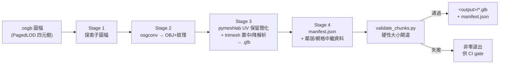

# Stage A:OSGB → 分塊 GLB 轉換器

將一個香港 CSDI「3D 視覺化地圖」圖幅(`.osgb`,PagedLOD 四元樹,單圖幅約 1.7 GB)轉換為空間分割的 `.glb` 分塊,供 Unity 執行時逐塊串流載入。所有路徑經 CLI 參數或環境變數傳入,**無寫死機器路徑**。



## 大小預算

| 項目 | 計畫預算 | 實測(11-NW-15B 九龍城區) |
|---|---|---|
| 單一 `.glb` 分塊 | ≤ 10 MB(目標 6–8 MB) | 0.54–0.76 MB |
| 全圖幅分塊總和 | ≤ 200 MB | 14.16 MB |
| 每次執行時載入 | ≤ 10 MB(逐塊串流) | 由 Stage B 串流器保證 |

實測 20 個分塊、~50,000 三角面、每塊保留 1 張紋理貼圖(九龍城區為低密度住宅區,
建築物高度 ~147 m,故網格較稀疏)。 dense 市區(如旺角 11-NW-19B)實測為 36.24 MB、
637,565 三角面、密集區 9–14 張張紋理/塊,仍在預算內。

## 必要工具

### 1. OpenSceneGraph(`osgconv`)— OSGB → OBJ 轉換

CSDI 的 `.osgb` 為 OpenSceneGraph 二進位 PagedLOD 格式,需 `osgconv` 轉為 OBJ(含紋理)。

- **Windows:** 自 [objexx.com/OpenSceneGraph.html](https://objexx.com/OpenSceneGraph.html) 下載 `OpenSceneGraph-3.6.5-VC2022-64-*.7z`,解壓後取 `bin\osgconv.exe`。需連帶 `bin\osgPlugins-3.6.5\` 目錄(OBJ 讀寫 plugin `osgdb_obj.dll` 在此)。
- **macOS:** `brew install open-scene-graph`
- **Linux:** `apt install openscenegraph`(或 `openscenegraph` 套件)

驗證:`osgconv --version` 應印出 `OpenSceneGraph Library 3.6.x`。

### 2. Python 3.10+ 與相依套件

```bash
python -m pip install -r codebase/converter/requirements.txt
```

相依:

- `pymeshlab>=2023.12` — UV 保留網格簡化(**唯一**能在簡化時保留 UV/紋理的工具;`pyfqmr` 與 `fast_simplification` 皆會丟失 UV,已驗證淘汰)
- `trimesh>=5.2` — OBJ 載入、置中、紋理降解析、GLB 匯出
- `Pillow>=10.0` — 紋理縮放
- `numpy>=2.0` — 陣列運算
- `py7zr>=1.0` — (可選)解壓 7z 封裝

> **pymeshlab DLL 警告無害:** 載入時會印出 `filter_embree.dll`、`filter_func.dll`、`io_3ds.dll` 等載入失敗警告——這些是選用 plugin(布耳運算、Sketchfab 上傳等),核心的 `meshing_decimation_quadric_edge_collapse_with_texture` 不依賴它們。轉換器已以 `warnings.filterwarnings("ignore")` 抑制。

## 使用方式

### 基本指令

```bash
python codebase/converter/convert_osgb_to_chunks.py \
  --input /path/to/11-NW-15B_OSGB.zip \
  --output /path/to/chunks_out \
  --osgconv /path/to/osgconv \
  --max-chunk-mb 8 \
  --max-total-mb 200 \
  --max-texture-px 512
```

`--input` 亦接受**已解壓的目錄**(結構為 `<root>/<SheetNo>-N/Tile_+X_+Y.osgb`)。輸入 zip 會先解壓到 `<output>/_work/osgb_extract/`。

### 高解析度輸出(80 MB 目標)

輸出大小主要由 **LOD + 紋理像素** 控制(單塊/總和預算僅為上限)。預設 `l16 + 512px` ≈ 20 MB/圖幅。80 MB 目標食譜:

```bash
python codebase/converter/convert_osgb_to_chunks.py \
  --input /path/to/11-NW-15B_OSGB.zip \
  --output /path/to/chunks_out_80mb \
  --osgconv /path/to/osgconv \
  --lod l17 --max-texture-px 1024
```

- `--lod l17`:三角面約 l16 的 4×(建物立面更細)。
- `--max-texture-px 1024`:紋理約 512px 的 4×(地面/空拍紋理更銳利,對地面視角 FPS 尤其重要)。
- 合計約 80 MB,每塊 ~4 MB,遠低於驗證閘道(≤ 10 MB/塊、≤ 200 MB 總和)。
- 若資料無 L17 檔(子圖幅目錄下無 `_L17_` 檔),fallback:`--lod l16 --max-texture-px 1536`(純紋理提升至 ~80 MB)。

### 完整參數

| 參數 | 預設 | 說明 |
|---|---|---|
| `--input` | (必填,或 `OSGB_INPUT`) | `.osgb.zip` 或已解壓目錄 |
| `--output` | (必填,或 `OSGB_OUTPUT`) | 輸出目錄 |
| `--osgconv` | `osgconv`(或 `OSGCONV_PATH`) | osgconv 執行檔路徑 |
| `--max-chunk-mb` | `8`(或 `MAX_CHUNK_MB`) | 單一 `.glb` 最大 MB |
| `--max-total-mb` | `200`(或 `MAX_TOTAL_MB`) | 全圖幅分塊總和最大 MB |
| `--max-texture-px` | `512`(或 `MAX_TEXTURE_PX`) | 紋理最長邊像素 |
| `--decimate-threshold` | `3000` | 低於此三角面數的網格不簡化 |
| `--lod` | `l16` | LOD 層級(`root` 或 `lNN`,如 `l15`/`l16`/`l17`/`l18`)。l17+ 一子圖幅多檔自動合併,三角面約 l16 的 4×(l17)/16×(l18) |
| `--verbose` | 關 | 除錯日誌 |

### 環境變數(可替代 CLI)

所有 `--xxx` 參數皆有對應環境變數(`OSGB_INPUT`、`OSGB_OUTPUT`、`OSGCONV_PATH`、`MAX_CHUNK_MB`、`MAX_TOTAL_MB`、`MAX_TEXTURE_PX`),便於 CI 注入。

## 輸出結構

```
<output>/
├── manifest.json
├── chunk_x245_y140.glb
├── chunk_x246_y140.glb
├── ...
└── chunk_x249_y143.glb
```

### `manifest.json` schema

```json
{
  "version": "1.0",
  "source": "11-NW-15B",
  "crs": "EPSG:2326",
  "origin": [37124.898, 21302.305, 77.536],
  "tileSize": [750.602, 605.023, 146.987],
  "gridCols": 5,
  "gridRows": 4,
  "chunkCount": 20,
  "totalBytes": 14160000,
  "totalTriangles": 50000,
  "attribution": "© 香港特別行政區地政總署 / Government of the Hong Kong SAR (Lands Department 3D Visualisation Map)",
  "chunks": [
    {
      "id": "x245_y140",
      "grid_x": 0,
      "grid_y": 0,
      "bbox_min": [-375.301, -302.512, -69.536],
      "bbox_max": [-225.181, -151.256, 77.536],
      "centroid": [-300.241, -226.884, 0.0],
      "file": "chunk_x245_y140.glb",
      "bytes": 660000,
      "triangles": 1830,
      "neighbors": ["x246_y140", "x245_y141"],
      "priority": 1
    }
  ]
}
```

- `origin`:全圖幅中心點(HK 1980 Grid 公尺,EPSG:2326),Unity 端以此為本地原點。
- `bbox_min`/`bbox_max`/`centroid`:已**相對 origin 置中**(本地座標,公尺),可直接餵給 Unity 的載入半徑計算。
- `grid_x`/`grid_y`:子圖幅在 5×4 網格中的欄列索引(0-based),供 Stage B 鄰近載入排序。
- `neighbors`:相鄰子圖幅的 chunk id 清單,供 Stage B 預載入。

## 驗證閘道(CI gate)

```bash
python codebase/converter/validate_chunks.py \
  --output /path/to/chunks_out \
  --max-chunk-mb 8 \
  --max-total-mb 200
```

- 任一 `.glb` > `--max-chunk-mb` → 退出碼 1
- 總和 > `--max-total-mb` → 退出碼 1
- manifest 欄位缺失 → 退出碼 1
- manifest 記錄的 `bytes` 與實際檔案大小不符 → 警告
- 全部通過 → 退出碼 0

CI 中應將此腳本作為 Stage B/C 前的必要 gate。

## 座標系與置中

CSDI OSGB 座標為 **EPSG:2326(HK 1980 Grid,公尺)**。轉換器:

1. 先掃描所有子圖幅的根 OBJ,計算全圖幅 bbox。
2. 取 bbox 中心為 `origin`(寫入 manifest)。
3. 每個分塊的頂點座標**減去 origin**後匯出 GLB——確保 Unity 端座標在 ±400 m 內,避免 float 精度問題。
4. manifest 的 `bbox_min`/`bbox_max`/`centroid` 皆為**本地座標**(已減 origin)。

Unity 端(Stage B)只需讀 `origin` 作為世界原點偏移,分塊內座標即為本地座標。

## 為何選 pymeshlab(而非 pyfqmr / fast_simplification)

經實測:

| 工具 | 保留 UV? | 保留紋理? | 備註 |
|---|---|---|---|
| `pymeshlab.meshing_decimation_quadric_edge_collapse_with_texture` | ✓ | ✓ | **採用** |
| `pyfqmr.Simplify` | ✗ | ✗ | 永遠丟失 UV,即使 `preserve_border=False` |
| `trimesh.simplify_quadric_decimation`(後端 `fast_simplification`) | ✗ | ✗ | 丟失 UV |

CSDI 攝影測量網格的價值在建築物紋理,丟失 UV 會讓密集市區(旺角核心)變成無紋理灰塊。pymeshlab 的 `with_texture` 變體在邊塌陷時維護 wedge(共享頂點的 UV 索引),是唯一可行的離線簡化方案。

## 疑難排解

### `osgconv 失敗 (rc=...)` 或產出無紋理 OBJ

- 確認 `--osgconv` 指向 `osgconv.exe`(Windows)或 `osgconv`(Unix),且**同目錄**有 `osgPlugins-3.6.5/`。
- 轉換器會自動設 `OSG_PLUGIN_PATH` 為 `<osgconv 目錄>/osgPlugins-<version>`。
- 手動驗證:`cd <空目錄> && osgconv <source>.osgb test.obj -O OutputTextureFiles`,確認產出 `.obj` + `.mtl` + 多個 `.jpg`。

### `.mtl` 引用絕對路徑(`F:\01_HK_2024\...`)

CSDI 的 osgconv 產出有時會以建置機絕對路徑引用紋理。轉換器已自動將 `map_Kd`/`map_Ks`/`map_Bump` 等行改寫為 basename-only(紋理檔已由 osgconv 以 basename 複製到 OBJ 旁)。若仍失敗,檢查 `<output>/_work/<subtile>/` 下的 `.mtl`。

### pymeshlab `Unknown format for save: glb`

pymeshlab 無法直接存 GLB。轉換器流程為 `pymeshlab 存 OBJ → trimesh 載入 → trimesh 匯出 GLB`,已內建處理。

### `Parameter preservetopology not found for filter ...with_texture`

`meshing_decimation_quadric_edge_collapse_with_texture` 僅接受 `targetfacenum`(其他參數如 `preservetopology`、`autoclean` 僅適用於無紋理變體 `meshing_decimation_quadric_edge_collapse`)。轉換器只傳 `targetfacenum`。

### 分塊仍超出 `--max-chunk-mb`

轉換器會做第二輪更激進簡化(`target = (budget/actual)^1.3 × current`)。若仍超出,降低 `--max-texture-px`(如 256)或提高 `--max-chunk-mb`。單一子圖幅的根 LOD 通常 ≤ 5 MB,極少觸發第二輪。

## 資料來源與授權

- 來源:香港地政總署「3D 視覺化地圖(圖幅式模型)」,下載自 [csdigeodata.gov.hd](https://csdigeodata.gov.hk/) / [data.gov.hk](https://data.gov.hk/)。
- 格式:`.osgb`(OpenSceneGraph 二進位 PagedLOD)。
- 授權:Open Government Data License。**必須標註**「© 香港特別行政區地政總署 / Government of the Hong Kong SAR (Lands Department 3D Visualisation Map)」——已寫入 `manifest.json` 的 `attribution` 欄位,Unity 端(Stage B)應於畫面或關於頁顯示。
- CSDI API key `ad5940a63bd344c48b0351ef1c7a905e` 為 CSDI 自身在其公開 GeoJSON 圖幅索引中發布的開放金鑰,非個別使用者機密。
