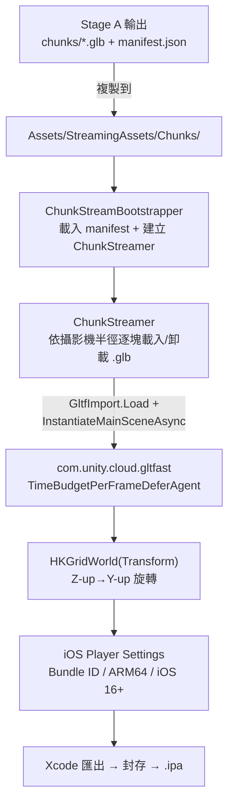

# Stage B/C:Unity 6 LTS 分塊串流器與 iOS 建置

此目錄為 Unity 6 LTS 專案根目錄。**目前為鷹架(scaffold)**:C# 腳本與套件清單已就位,但未經 Unity 編譯驗證。需先安裝 Unity 6 LTS + iOS Build Support,再以此目錄建立專案。



## 前置需求

1. **Unity Hub** + **Unity 6 LTS**(6000.0.x)+ **iOS Build Support** 模組
2. **Stage A 已完成**:已產出 `<output>/manifest.json` + `<output>/chunk_*.glb`(見 `../converter/README.md`)
3. **Xcode**(macOS,供 Stage C 封存 `.ipa`;Windows 僅能開發/測試,無法建置 iOS)

## 首次建立專案(安裝 Unity 後)

1. Unity Hub → Add → Add project from disk → 選此目錄(`codebase/unity-project/`)。
2. 若 Hub 提示「不是有效專案」:改用 New Project → 3D (URP 或 Built-in 皆可) → 建立到**暫存位置**,再把產生的 `ProjectSettings/`、`Packages/manifest.json` 合併進此目錄(保留此處已有的 `Assets/Scripts/` 與自訂 `manifest.json` 套件清單)。
3. 開啟專案 → Package Manager 確認 `Unity glTFast`(`com.unity.cloud.gltfast` 6.0+)已安裝。
4. 等待編譯 → 修正任何鷹架腳本的 API 差異(見下方「已知待驗證」)。

## 放入分塊資料

```bash
# 假設 Stage A 輸出在 ~/chunks_out
mkdir -p codebase/unity-project/Assets/StreamingAssets/Chunks
cp ~/chunks_out/manifest.json codebase/unity-project/Assets/StreamingAssets/Chunks/
cp ~/chunks_out/chunk_*.glb   codebase/unity-project/Assets/StreamingAssets/Chunks/
```

iOS 上 `Application.streamingAssetsPath` 指向封裝內唯讀目錄,`file://` 前綴由 `ChunkStreamer.GetChunkPath` 自動加上。

## 場景設定

1. 新增空 GameObject,命名 `GridStreamer`,掛上 `ChunkStreamBootstrapper`。
2. Inspector 指派:
   - **Config**:Assets > Create > HKGrid > ChunkStreamConfig(產生後調整半徑/預算)
   - **Camera**:主攝影機
3. 主攝影機掛上 `FlyCameraController`(WASD 飛覽、右鍵轉向、Shift 加速)。
4. 攝影機起始位置:在 Bootstrapper 勾選 `Override Start Pos`,設 `Start Local Pos`(本地網格座標,公尺)。預設 `(0, 80, 0)` = 圖幅中心上空 80 m。
5. Play → Console 應印出 manifest 摘要 + 授權標註,分塊依攝影機位置逐塊載入。

## 座標系轉換

| 空間 | 軸向 | 說明 |
|---|---|---|
| HK 1980 Grid(EPSG:2326) | X=東, Y=北, Z=上(Z-up) | Stage A 的 manifest `origin` 與 chunk 座標 |
| 本地網格座標(已置中) | X=東, Y=北, Z=上(Z-up) | manifest 的 bbox/centroid(已減 origin) |
| Unity 世界座標 | X=東, Y=上, Z=南(Y-up) | `HKGridWorld` 套用 −90° X 旋轉轉換 |

`ChunkStreamer` 內部將攝影機世界座標逆旋轉回本地網格座標,以 manifest centroid 計算距離,決定載入/卸載。旋轉不改變距離,故串流邏輯正確。

## iOS Player Settings(Stage C)

於 Project Settings > Player > iOS 設定:

| 設定 | 值 | 原因 |
|---|---|---|
| Bundle Identifier | `com.mccmak.hk3dgrid` | 與既有 Swift App 區隔 |
| Scripting Backend | IL2CPP | iOS 必備(ARM64) |
| Target Device | iPhone | |
| Target iOS Version | 16.0 | 與既有 App 一致 |
| Architecture | ARM64 | iOS 必備 |
| Camera Usage Description | (若用 ARKit) | 純飛覽不需 |
| Color Space | Linear | glTF/PBR 正確呈現 |
| Strip Engine Code | Yes | 縮小 .ipa |

**未簽署建置**(對應 ADR-001,供側載):在 Build Settings 取消簽署,或建置後以 `CODE_SIGNING_ALLOWED=NO` 封存。Xcode 端 `Product > Archive` 後,以 AltStore/SideStore/Sideloadly 用免費 Apple ID 簽署。

## 已知待驗待驗證(鷹架風險)

以下 C# API 依 glTFast 6.0 官方文件撰寫,但未經 Unity 編譯驗證。首次開啟專案時需檢查:

1. **`GltfImport` 建構式** — `new GltfImport(IDeferAgent, ICodeLogger)` 的確切簽名(可能需加 `IDownloadProvider`)。
2. **`GameObjectInstantiator` 建構式** — `new GameObjectInstantiator(gltf, parent, logger)` 的參數順序與數量。
3. **`TimeBudgetPerFrameDeferAgent.frameBudget`** — 欄位名稱可能為 `FrameBudget`(大寫)或屬性。
4. **`GltfImport.SetDefaultDeferAgent`** — 靜態方法是否存在於 6.0,或需改用 prefab `glTF-StableFramerate.prefab`。
5. **`ImportSettings` 欄位** — `generateNormals` 等欄位名稱需對照 6.0 API。
6. **`JsonUtility` 與 manifest.json** — `long` 型別(totalBytes)在 JsonUtility 中需確認可正確反序列化;若不行改用 `double` 或 Newtonsoft。

修正方式:開啟專案 → 看 Console 編譯錯誤 → 對照 [glTFast 6.0 API 文件](https://docs.unity3d.com/Packages/com.unity.cloud.gltfast@6.0/api/index.html)調整簽名。

## 檔案清單

```
codebase/unity-project/
├── Packages/
│   └── manifest.json              # glTFast + UGUI + WebRequest 模組
├── Assets/
│   ├── Scripts/
│   │   ├── ChunkManifest.cs       # manifest.json 資料模型
│   │   ├── ChunkStreamConfig.cs   # ScriptableObject 設定
│   │   ├── ChunkStreamer.cs       # 核心串流器(gltfImport + 空間載入/卸載)
│   │   ├── ChunkStreamBootstrapper.cs  # 場景入口(載 manifest + 驅動)
│   │   └── FlyCameraController.cs # WASD 飛覽攝影機
│   └── StreamingAssets/
│       └── Chunks/                # Stage A 產物放此(manifest.json + *.glb)
└── README.md                      # 本檔
```

`ProjectSettings/`、`Library/`、`Temp/` 等由 Unity 首次開啟時自動產生,已加入 `.gitignore`。
