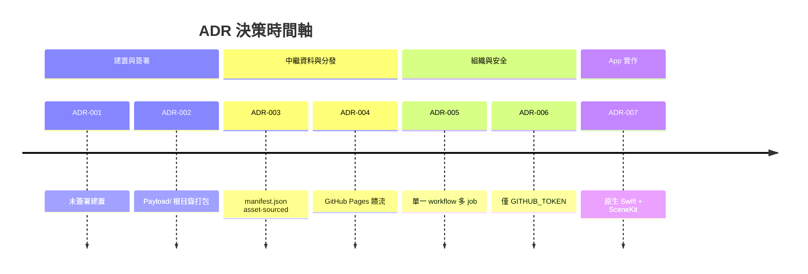

# 架構決策紀錄

本文件記錄 ios-app 零成本 iOS CI/CD pipeline 的關鍵架構決策（Architecture Decision Records, ADR）。每筆紀錄包含編號、標題、狀態、內容、決策與後果。狀態皆為「已接受」。

---

## ADR-001：使用未簽署建置

- **狀態：** 已接受
- **內容：** pipeline 需在無付費 Apple Developer Program 的前提下產出可側載的 IPA。傳統做法（`fastlane match`、簽署憑證、provisioning profile、App Store Connect keys）皆需 Apple 機密，無法在零 secret 的 fork 上運作。
- **決策：** 每次 `xcodebuild` 呼叫（測試、建置、封存）一律帶上四個未簽署旗標：`CODE_SIGNING_ALLOWED=NO CODE_SIGNING_REQUIRED=NO CODE_SIGN_IDENTITY="" CODE_SIGN_ENTITLEMENTS=""`。實作見 `../codebase/scripts/build_unsigned_ipa.sh`。
- **後果：** IPA 不含簽章，需由 AltStore/SideStore/Sideloadly 以使用者免費 Apple ID 現場簽署。免費憑證每 7 天過期，促成 Releases + 饋流自動重灌流程（見 ADR-004）。CI 可在零 Apple 機密下完整運作。

## ADR-002：IPA 打包為 Payload/<App>.app 在 zip 根目錄

- **狀態：** 已接受
- **內容：** AltStore 與 Sideloadly 僅接受 `Payload/<App>.app/...` 位於 zip 根目錄的 IPA。直接壓縮裸 `.app`、或從 `Payload/` 內部壓縮，皆會被拒絕。
- **決策：** 以 `ditto` 將 `.app` 複製進暫存目錄的 `Payload/`（保留 framework 符號連結與中繼資料），再 `cd` 到含 `Payload/` 的目錄執行 `zip -r "<App>-<Ver>.ipa" Payload`，並以 `unzip -l` 驗證版面。實作見 `../codebase/scripts/build_unsigned_ipa.sh`。
- **後果：** 產出的 IPA 可被 AltStore/SideStore/Sideloadly 直接安裝。`ditto` 僅在 macOS 可用，故建置限定 `macos-latest` runner。

## ADR-003：透過 manifest.json 資產傳遞 asset-sourced 中繼資料

- **狀態：** 已接受
- **內容：** 饋流產生器需知道 App 名稱、bundleIdentifier、版本、檔名。若在饋流腳本中猜測或硬編碼，會與實際建置結果脫鉤。
- **決策：** 建置腳本從已建置 `Info.plist`（`CFBundleName`/`CFBundleShortVersionString`/`CFBundleIdentifier`）萃取值，寫入 `manifest.json` 並作為 Release 資產上傳。饋流產生器 `../codebase/scripts/generate_apps_json.sh` 下載該資產，從中讀取這些欄位（`version`、`bundleIdentifier`、`appName`）。
- **後果：** 饋流的 App 身分欄位永遠對應到實際建置物，而非猜測。新增欄位需同時更新 manifest schema 與饋流產生器。

## ADR-004：GitHub Pages 部署 AltStore/SideStore 來源饋流

- **狀態：** 已接受
- **內容：** 免費 Apple ID 憑證每 7 天過期，使用者需重新安裝/刷新。需要一個無後端、自動更新、零成本的分發管道。
- **決策：** 以 GitHub Pages 託管靜態入口網站（`../codebase/site/`）與 `apps.json` 饋流。來源 URL 為 `https://mcc-mak.github.io/ios-app/apps.json`。`apps.json` 於每次發行後由 `../.github/workflows/cicd.yml` 的 `deploy:docs` job 重新產生。儲存庫 Pages 設定必須為 **Source: GitHub Actions**。
- **後果：** 無伺服器維護成本；饋流隨發行自動更新。使用者於 AltStore/SideStore 加入來源後，可一鍵安裝並於 7 天週期內刷新。

## ADR-005：單一工作流程、多 job（階段化管線）

- **狀態：** 已接受（取代原本「每支 workflow 一項職責」的分割）
- **內容：** 多支 workflow 需要以 `gh workflow run` 交叉觸發，難以一眼看懂階段順序，也重複 checkout 與建置；使用者要求可追溯的單一鏈路。
- **決策：** `.github/workflows/cicd.yml` 為唯一工作流程，依序 `test:sast` → `build:ipa` → `release:ipa` → `deploy:docs`；job 之間以 `needs` 與 artifacts 傳遞產物，不再交叉觸發。工作流程名稱不含冒號，job 顯示名稱為 `階段:產物`，權限下放到各 job（`security-events: write`、`contents: write`、`pages: write` + `id-token: write`）。
- **後果：** 一次執行即可看到完整鏈路，發行與部署有明確順序，權限仍最小化。代價是單一檔案較長，且 `deploy:docs` 需要 `build:ipa` 成功；每日健康檢查改由 `schedule` 觸發同一條 `test:sast` → `build:ipa`。

## ADR-006：僅使用 GITHUB_TOKEN，零 Apple 機密

- **狀態：** 已接受
- **內容：** 引入任何 Apple 機密（certs、profiles、App Store Connect keys）即破壞「零成本、可 fork」前提。
- **決策：** 全 pipeline 僅使用內建 `GITHUB_TOKEN`（`permissions` 於 `cicd.yml` 各 job 內宣告最小範圍）。永不引入 `fastlane match`、簽署憑證、provisioning profile 或 App Store Connect keys。
- **後果：** 任何 fork 在零額外 secret 設定下即可運作 CI。安全性完全依賴 GitHub 內建權限模型，無外部信任邊界。

## ADR-007：以原生 Swift + SceneKit 實作體素 App（非 Unity + Cesium）

- **狀態：** 已接受
- **內容：** App 需求為「3D HK Minecraft」體素飛覽。Unity iOS 建置需 Unity 授權（即使 Personal 亦需啟用機密）；Cesium for Unity 需 Cesium ion 權杖。兩者皆與 ADR-006「僅 `GITHUB_TOKEN`、零機密、可 fork」硬性限制衝突，且維護者無法提供 Unity 授權機密、亦不在本機安裝 Unity。
- **決策：** 以原生 Swift + SceneKit + Metal 實作體素地形飛覽（`../codebase/app/HKMinecraftVoxel/`）。地形資料來源抽象為 `TerrainDataSource` 協定，預設 `ProceduralHKTerrain`（離線程序化香港山脊），`CSDIDEMTerrain` 為未來接 HK CSDI 開放資料 DEM 的擴充點（無需 ion 權杖）。沿用既有 `xcodebuild` 未簽署建置管線，無需任何新機密。
- **後果：** 無 Unity/Cesium 相依，CI 仍僅用 `GITHUB_TOKEN`，確定性建置。視覺效果受限於 SceneKit（無 Cesium 3D Tiles 真實攝影測量），但可完全離線運作。未來若取得 Unity 授權與 ion 權杖，可重訪 Unity 方案（需先放寬 ADR-006）。

## ADR-008：直接顯示 CSDI 真實網格(非體素化)並以離線簡化縮小檔案

- **狀態：** 已接受
- **內容：** 使用者要求以香港 CSDI 開放資料的真實 3D 模型檔(非程序化、非猜測)呈現旺角。CSDI 地政總署「3D 視覺化地圖(圖幅式模型)」涵蓋全港,每個圖幅(約 700 m × 550 m)提供 OBJ/OSGB/Cesium 3D Tiles 三種格式。然而單一圖幅的完整檔案為 1.7–11 GB(含多 LOD 攝影測量網格與高解析紋理),無法打包進可側載的 IPA,亦無法在行動裝置上即時串流。CSDI 的非紋理 3D Tiles API 需申請 API key(= 機密,違反 ADR-006)。使用者要求「真實紋理網格直接顯示」而非體素化。
- **決策：** 採用 OSGB 格式(單一圖幅 1.70 GB,為三種格式中最小),取其根 LOD(最粗略層級,20 個子圖幅的根 `.osgb`,共 27 MB)以 `osgconv` 轉為 OBJ,再以 `trimesh` + `pyfqmr`(`preserve_border=False`)離線簡化至 179,811 三角面。較小的網格保留完整紋理(UV + 256px 貼圖),較大的密集網格因 pyfqmr 不保留 UV 而改用頂點色(取自原紋理平均色)。結果輸出為 glTF 二進位檔(.glb,7.5 MB)隨 App 打包,座標系 EPSG:2326 已重新置中至圖幅中心。攝影機以 300 m AGL 射線取樣貼地巡航。API key `ad5940a63bd344c48b0351ef1c7a905e` 為 CSDI 自身在公開 GeoJSON 圖幅索引中發布的開放金鑰,非個別使用者機密,不違反 ADR-006。
- **後果：** App 內含真實旺角建築/地形幾何(非程序化),7.5 MB 可輕易打包進 IPA。密集核心區(旺角主要建築)因簡化失去細部紋理,僅保留頂點色調;邊緣稀疏區保留完整紋理。179k 三角面對中階 iPhone 可流暢算繪。未來若需更高品質,可改為 CI 端離線簡化單一 CESIUM 圖幅(含多 LOD),或改用 runtime 3D Tiles 串流(需放寬 ADR-006 以接受 API key)。資料授權要求標註「© 香港特別行政區地政總署」。

---

## 關聯文件

- 架構總覽與資料流：`./architecture.md`
- 饋流與 manifest 介面契約：`./api.md`
- 欄位結構定義：`./schema.md`
