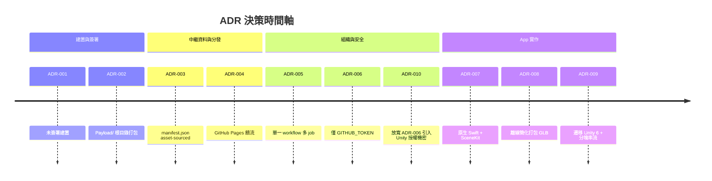

# 架構決策紀錄

本文件記錄 ios-app 零成本 iOS CI/CD pipeline 的關鍵架構決策（Architecture Decision Records, ADR）。每筆紀錄包含編號、標題、狀態、內容、決策與後果。狀態皆為「已接受」。

---

## ADR-001：使用未簽署建置

- **狀態：** 已接受
- **內容：** pipeline 需在無付費 Apple Developer Program 的前提下產出可側載的 IPA。傳統做法（`fastlane match`、簽署憑證、provisioning profile、App Store Connect keys）皆需 Apple 機密，無法在零 secret 的 fork 上運作。
- **決策：** 每次 `xcodebuild` 呼叫（測試、建置、封存）一律帶上四個未簽署旗標：`CODE_SIGNING_ALLOWED=NO CODE_SIGNING_REQUIRED=NO CODE_SIGN_IDENTITY="" CODE_SIGN_ENTITLEMENTS=""`。實作見 `../codebase/scripts/build_unsigned_ipa.sh`。
- **後果：** IPA 不含簽章，需由 AltStore/SideStore/Sideloadly 以使用者免費 Apple ID 現場簽署。免費憑證每 7 天過期，促成 Releases + 饋流自動重灌流程（見 ADR-004）。CI 可在零 Apple 機密下完整運作。

## ADR-002：IPA 打包為 Payload/<App>.app 在 zip 根目錄

- **狀態：** 已接受
- **內容：** AltStore 與 Sideloadly 僅接受 `Payload/<App>.app/...` 位於 zip 根目錄的 IPA。直接壓縮裸 `.app`、或從 `Payload/` 內部壓縮，皆會被拒絕。
- **決策：** 以 `ditto` 將 `.app` 複製進暫存目錄的 `Payload/`（保留 framework 符號連結與中繼資料），再 `cd` 到含 `Payload/` 的目錄執行 `zip -r "<App>-<Ver>.ipa" Payload`，並以 `unzip -l` 驗證版面。實作見 `../codebase/scripts/build_unsigned_ipa.sh`。
- **後果：** 產出的 IPA 可被 AltStore/SideStore/Sideloadly 直接安裝。`ditto` 僅在 macOS 可用，故建置限定 `macos-latest` runner。

## ADR-003：透過 manifest.json 資產傳遞 asset-sourced 中繼資料

- **狀態：** 已接受
- **內容：** 饋流產生器需知道 App 名稱、bundleIdentifier、版本、檔名。若在饋流腳本中猜測或硬編碼，會與實際建置結果脫鉤。
- **決策：** 建置腳本從已建置 `Info.plist`（`CFBundleName`/`CFBundleShortVersionString`/`CFBundleIdentifier`）萃取值，寫入 `manifest.json` 並作為 Release 資產上傳。饋流產生器 `../codebase/scripts/generate_apps_json.sh` 下載該資產，從中讀取這些欄位（`version`、`bundleIdentifier`、`appName`）。
- **後果：** 饋流的 App 身分欄位永遠對應到實際建置物，而非猜測。新增欄位需同時更新 manifest schema 與饋流產生器。

## ADR-004：GitHub Pages 部署 AltStore/SideStore 來源饋流

- **狀態：** 已接受
- **內容：** 免費 Apple ID 憑證每 7 天過期，使用者需重新安裝/刷新。需要一個無後端、自動更新、零成本的分發管道。
- **決策：** 以 GitHub Pages 託管靜態入口網站（`../codebase/site/`）與 `apps.json` 饋流。來源 URL 為 `https://mcc-mak.github.io/ios-app/apps.json`。`apps.json` 於每次發行後由 `../.github/workflows/cicd.yml` 的 `deploy:docs` job 重新產生。儲存庫 Pages 設定必須為 **Source: GitHub Actions**。
- **後果：** 無伺服器維護成本；饋流隨發行自動更新。使用者於 AltStore/SideStore 加入來源後，可一鍵安裝並於 7 天週期內刷新。

## ADR-005：單一工作流程、多 job（階段化管線）

- **狀態：** 已接受（取代原本「每支 workflow 一項職責」的分割）
- **內容：** 多支 workflow 需要以 `gh workflow run` 交叉觸發，難以一眼看懂階段順序，也重複 checkout 與建置；使用者要求可追溯的單一鏈路。
- **決策：** `.github/workflows/cicd.yml` 為唯一工作流程，依序 `test:sast` → `build:ipa` → `release:ipa` → `deploy:docs`；job 之間以 `needs` 與 artifacts 傳遞產物，不再交叉觸發。工作流程名稱不含冒號，job 顯示名稱為 `階段:產物`，權限下放到各 job（`security-events: write`、`contents: write`、`pages: write` + `id-token: write`）。
- **後果：** 一次執行即可看到完整鏈路，發行與部署有明確順序，權限仍最小化。代價是單一檔案較長，且 `deploy:docs` 需要 `build:ipa` 成功；每日健康檢查改由 `schedule` 觸發同一條 `test:sast` → `build:ipa`。

## ADR-006：僅使用 GITHUB_TOKEN,零 Apple 機密

- **狀態：** 已接受(ADR-010 部分放寬:Unity 建置階段引入 Unity 授權機密,Apple 簽署機密仍維持零)
- **內容：** 引入任何 Apple 機密（certs、profiles、App Store Connect keys）即破壞「零成本、可 fork」前提。
- **決策：** 全 pipeline 僅使用內建 `GITHUB_TOKEN`（`permissions` 於 `cicd.yml` 各 job 內宣告最小範圍）。永不引入 `fastlane match`、簽署憑證、provisioning profile 或 App Store Connect keys。
- **後果：** 任何 fork 在零額外 secret 設定下即可運作 CI。安全性完全依賴 GitHub 內建權限模型,無外部信任邊界。**注意:** ADR-009 遷移 Unity 後,Unity 建置階段需 Unity 授權檔(`.ulf`)作為 secret(見 ADR-010),此為 Unity 引擎授權而非 Apple 簽署機密;Apple 簽署仍維持未簽署(ADR-001)由使用者側載。

## ADR-007：以原生 Swift + SceneKit 實作體素 App(非 Unity + Cesium)

- **狀態：** 已取代(由 ADR-009 取代)
- **內容：** App 需求為「3D HK Minecraft」體素飛覽。Unity iOS 建置需 Unity 授權（即使 Personal 亦需啟用機密）；Cesium for Unity 需 Cesium ion 權杖。兩者皆與 ADR-006「僅 `GITHUB_TOKEN`、零機密、可 fork」硬性限制衝突，且維護者無法提供 Unity 授權機密、亦不在本機安裝 Unity。
- **決策：** 以原生 Swift + SceneKit + Metal 實作體素地形飛覽（`../codebase/app/HKMinecraftVoxel/`）。地形資料來源抽象為 `TerrainDataSource` 協定，預設 `ProceduralHKTerrain`（離線程序化香港山脊），`CSDIDEMTerrain` 為未來接 HK CSDI 開放資料 DEM 的擴充點（無需 ion 權杖）。沿用既有 `xcodebuild` 未簽署建置管線，無需任何新機密。
- **後果：** 無 Unity/Cesium 相依，CI 仍僅用 `GITHUB_TOKEN`，確定性建置。視覺效果受限於 SceneKit（無 Cesium 3D Tiles 真實攝影測量），但可完全離線運作。**已由 ADR-009 取代:** 使用者明確要求遷移至 Unity 6 LTS 以取得真實 CSDI 攝影測量網格的完整紋理呈現與執行時分塊串流,並接受 Unity 授權機密(ADR-010)。

## ADR-008：直接顯示 CSDI 真實網格(非體素化)並以離線簡化縮小檔案

- **狀態：** 已取代(由 ADR-009 取代)
- **內容：** 使用者要求以香港 CSDI 開放資料的真實 3D 模型檔(非程序化、非猜測)呈現旺角。CSDI 地政總署「3D 視覺化地圖(圖幅式模型)」涵蓋全港,每個圖幅(約 700 m × 550 m)提供 OBJ/OSGB/Cesium 3D Tiles 三種格式。然而單一圖幅的完整檔案為 1.7–11 GB(含多 LOD 攝影測量網格與高解析紋理),無法打包進可側載的 IPA,亦無法在行動裝置上即時串流。CSDI 的非紋理 3D Tiles API 需申請 API key(= 機密,違反 ADR-006)。使用者要求「真實紋理網格直接顯示」而非體素化。
- **決策：** 採用 OSGB 格式(單一圖幅 1.70 GB,為三種格式中最小),取其根 LOD(最粗略層級,20 個子圖幅的根 `.osgb`,共 27 MB)以 `osgconv` 轉為 OBJ,再以 `trimesh` + `pyfqmr`(`preserve_border=False`)離線簡化至 179,811 三角面。較小的網格保留完整紋理(UV + 256px 貼圖),較大的密集網格因 pyfqmr 不保留 UV 而改用頂點色(取自原紋理平均色)。結果輸出為 glTF 二進位檔(.glb,7.5 MB)隨 App 打包,座標系 EPSG:2326 已重新置中至圖幅中心。攝影機以 300 m AGL 射線取樣貼地巡航。API key `ad5940a63bd344c48b0351ef1c7a905e` 為 CSDI 自身在公開 GeoJSON 圖幅索引中發布的開放金鑰,非個別使用者機密,不違反 ADR-006。
- **後果：** App 內含真實旺角建築/地形幾何(非程序化),7.5 MB 可輕易打包進 IPA。密集核心區(旺角主要建築)因簡化失去細部紋理,僅保留頂點色調;邊緣稀疏區保留完整紋理。**已由 ADR-009 取代:** pyfqmr 丟失 UV 的缺陷已由 pymeshlab 的 `meshing_decimation_quadric_edge_collapse_with_texture`(保留 UV/紋理)修正;打包單一 GLB 的方式已改為分塊串流(每子圖幅一個 .glb),讓全圖幅 36 MB 的高品質網格可逐塊載入而非一次打包。

## ADR-009：遷移 Unity 6 LTS + 分塊 GLB 串流(取代 Swift/SceneKit)

- **狀態：** 已接受(取代 ADR-007 與 ADR-008)
- **內容：** 使用者要求以真實 CSDI 攝影測量網格呈現香港 3D 地形,並以執行時分塊串流(runtime chunk streaming)在行動裝置上載入全圖幅(1.7 GB OSGB → ≤ 200 MB 分塊 GLB)。Swift/SceneKit 方案(ADR-007)與打包單一 GLB 方案(ADR-008)皆無法支援:(a) SceneKit 缺乏 `glTFast` 等級的執行時 GLB 串流與 frame-budgeted defer agent;(b) 打包單一 GLB 限於 ≤ 10 MB,無法容納全圖幅高品質網格;(c) ADR-008 的 pyfqmr 簡化會丟失 UV,密集市區失去紋理。
- **決策：** 三階段管線:
  1. **Stage A(純 Python):** `codebase/converter/convert_osgb_to_chunks.py` 以 `osgconv`(OSGB→OBJ+紋理)+ `pymeshlab`(`meshing_decimation_quadric_edge_collapse_with_texture`,**保留 UV/紋理**)+ `trimesh`(置中、紋理降解析、GLB 匯出)將單一 OSGB 圖幅轉為空間分塊(每子圖幅一個 `.glb`,≤ 10 MB/塊,總和 ≤ 200 MB),附 `manifest.json`(chunk id、bbox、centroid、鄰居、三角面數、位元組數)。`validate_chunks.py` 為硬性大小閘道。
  2. **Stage B(Unity 6 LTS):** `codebase/unity-project/` 使用 `com.unity.cloud.gltfast`(`GltfImport` + `InstantiateMainSceneAsync` + `Dispose()`)執行時逐塊載入 GLB,以 `TimeBudgetPerFrameDeferAgent` 限制每幀載入預算,依攝影機半徑載入/卸載鄰近分塊,HK 座標(EPSG:2326)正規化至本地原點(以 manifest `origin` 為偏移)。
  3. **Stage C(iOS):** Unity iOS Player Settings + Xcode 匯出/封存為單一 `.ipa`(沿用 ADR-001 未簽署旗標供側載)。
  - 採用 **Unity 6 LTS**(最新 LTS,最佳 glTFast 支援)。
  - 分塊策略:每個 CSDI 子圖幅(`Tile_+X_+Y`)= 一個 `.glb` 分塊(11-NW-19B 為 5×4 = 20 塊,自然空間單元)。
  - 無寫死機器路徑:轉換器經 CLI/環境變數傳入路徑,Unity 端經 ScriptableObjects/設定檔。
- **後果：**
  - **真實紋理:** pymeshlab UV 保留簡化讓密集市區(旺角核心)保留建築物紋理,而非 ADR-008 的頂點色灰塊。
  - **全圖幅載入:** 分塊串流讓 36 MB(11-NW-19B 實測)的全圖幅網格可逐塊載入,記憶體扁平化。
  - **代價:** Unity 建置需 Unity 授權機密(見 ADR-010,放寬 ADR-006 的零機密前提);維護者需在本機安裝 Unity Hub + Unity 6 LTS + iOS Build Support 模組;CI 需 GameCI + `.ulf` secret。
  - Stage A 已驗證(11-NW-19B:20 塊、36.24 MB、637,565 三角面、全塊保留紋理)。Stage B/C 待 Unity 安裝後實作。

## ADR-010：引入 Unity 授權檔(.ulf)作為 CI secret(放寬 ADR-006)

- **狀態：** 已接受(放寬 ADR-006,使用者明確同意)
- **內容：** ADR-009 遷移 Unity 後,CI 需以 GameCI 在 GitHub Actions 執行 Unity 建置。Unity 引擎授權(即使 Personal 免費版)需以授權檔(`.ulf`)啟用,該檔含機器指紋與啟用權杖,無法公開。此與 ADR-006「僅 `GITHUB_TOKEN`、零機密、可 fork」的前提衝突。
- **決策：** **僅**為 Unity 建置階段引入 Unity 授權檔作為 GitHub Actions secret(`UNITY_LICENSE`),經 GameCI `unity-request-manual-activation-file` / `unity-activate` 工作流程產生並加密儲存。其餘階段(測試、文件部署、Release 上傳、AltStore 饋流)仍僅用 `GITHUB_TOKEN`。Apple 簽署機密(cert、profile、App Store Connect key)**仍維持零**(沿用 ADR-001 未簽署建置 + 側載)。
- **後果：**
  - Fork 需自行設定 `UNITY_LICENSE` secret 才能執行 Unity 建置 job(否則該 job 跳過或失敗);其餘 CI 階段仍可在零 secret 下運作。
  - 信任邊界擴大:除 GitHub 內建權限外,新增 Unity 授權伺服器為信任對象(授權驗證時的網路往返)。
  - 使用者明確接受此放寬(問答中選擇「CI with Unity license secret」)。
  - ADR-006 的 Apple 機密零容忍維持不變;此 ADR 僅放寬 Unity 引擎授權。

---

## 關聯文件

- 架構總覽與資料流：`./architecture.md`
- 饋流與 manifest 介面契約：`./api.md`
- 欄位結構定義：`./schema.md`
