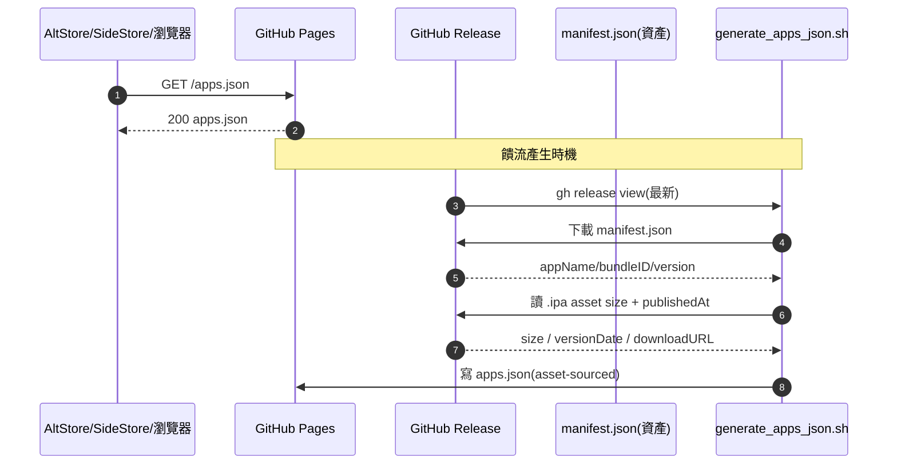

# API 規格

ios-app 不提供傳統後端 API。此處的「API」指三份對外契約：**AltStore/SideStore 來源饋流**（`apps.json`）、**建置中繼資料**（`manifest.json`）、以及 **GitHub Release 資產命名慣例**。所有內容皆為公開儲存庫、免驗證存取。



## 1. AltStore/SideStore 來源饋流

| 項目 | 值 |
| --- | --- |
| 端點 URL | `https://mcc-mak.github.io/ios-app/apps.json` |
| 方法 | `GET` |
| 認證 | 無（公開儲存庫） |
| Content-Type | `application/json` |
| 字元編碼 | UTF-8 |
| 產生者 | `../codebase/scripts/generate_apps_json.sh`（由 `../.github/workflows/pages.yml` 呼叫） |
| 更新時機 | 每次發行後（`release.yml` 觸發 `pages.yml`）；站台/設定變更 push 至 `main` 時 |

### 回應結構（apps.json）

```json
{ "name": "ios-app 來源", "subtitle": "...", "description": "...", "website": "...", "iconURL": "",
  "apps": [{ "name": "ios-app", "bundleIdentifier": "com.example.app", "developerName": "Mcc-Mak",
    "version": "1.0.0", "versionDate": "2026-11-18T08:00:00Z", "versionDescription": "...",
    "downloadURL": "https://github.com/Mcc-Mak/ios-app/releases/download/v1.0.0/ios-app-1.0.0.ipa",
    "size": 1234567, "iconURL": "" }] }
```

無發行版本時回傳合法空饋流 `{ ..., "apps": [] }`（入口網站據此顯示「尚無發行版本」）。完整逐欄定義見 `./schema.md`。

### 欄位來源分類

| 欄位層級 | 來源 | 說明 |
| --- | --- | --- |
| 饋流層（`name`/`subtitle`/`description`/`website`/`iconURL`） | **config** | 來自 `../codebase/app.config.json`。 |
| App 層 `developerName` | **config** | 來自 `app.config.json`。 |
| App 層 `version`/`bundleIdentifier`/`appName` | **asset-sourced** | 取自 Release 的 `manifest.json` 資產（fallback 見 `./schema.md`）。 |
| App 層 `versionDate` | **asset-sourced** | Release `publishedAt`（ISO 8601）。 |
| App 層 `size` | **asset-sourced** | Release `.ipa` 資產的位元組數。 |
| App 層 `downloadURL` | **asset-sourced** | `https://github.com/<owner>/<repo>/releases/download/<tag>/<App>-<Ver>.ipa`。 |

> **硬性規則：** `version`、`versionDate`、`size`、`downloadURL` 必須 asset-sourced，不得猜測。

## 2. manifest.json 契約

由 `../codebase/scripts/build_unsigned_ipa.sh` 從已建置 `Info.plist` 產生，作為 Release 資產上傳。欄位：`appName`、`bundleIdentifier`、`version`、`ipaFileName`、`dsymFileName`（皆 asset-sourced，見 `./schema.md`）。範例：

```json
{ "appName": "ios-app", "bundleIdentifier": "com.example.app", "version": "1.0.0",
  "ipaFileName": "ios-app-1.0.0.ipa", "dsymFileName": "ios-app-1.0.0.dSYM.zip" }
```

## 3. GitHub Release 資產命名慣例

每個 `v*` semver tag 發行版本固定附三個資產，檔名由 `manifest.json` 決定：

| 資產 | 檔名模式 | 內容 |
| --- | --- | --- |
| IPA | `<App>-<Ver>.ipa` | 未簽署 IPA，`Payload/<App>.app` 在 zip 根目錄 |
| dSYM | `<App>-<Ver>.dSYM.zip` | 封存中的 dSYM 符號檔 |
| 中繼資料 | `manifest.json` | asset-sourced App 身分（見上節） |

- `<App>` 與 `<Ver>` 取自建置物 `Info.plist`，不硬編碼。
- `downloadURL` 一律為直接瀏覽器下載 URL（公開儲存庫免驗證）。
- 發行說明（`versionDescription`）= `gh release create --generate-notes` 產生的 Release body。

## 關聯文件

- 欄位完整綱要：`./schema.md`　·　實體關係：`./erd.md`　·　決策：`./adr.md`（ADR-003/004）
