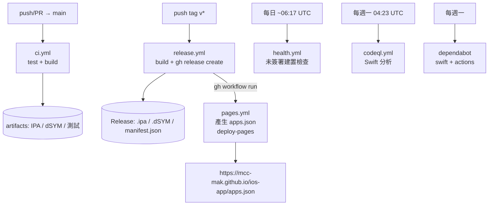
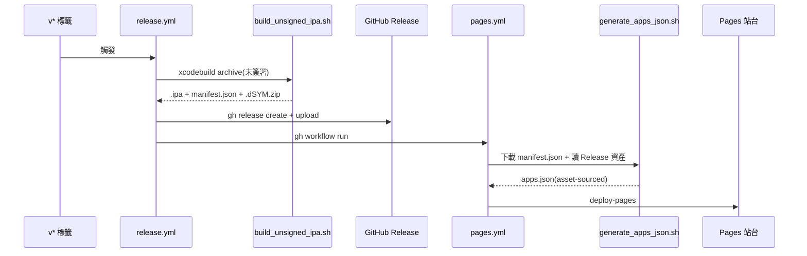

# 架構概觀

ios-app 是一套**零成本 iOS CI/CD pipeline**，以未簽署建置 + GitHub Release + GitHub Pages 饋流，支援免費 Apple ID 側載。全程僅用內建 `GITHUB_TOKEN`，無任何 Apple 機密。

## Pipeline 觸發與流程

## 資料流

建置物從 Xcode 流到使用者裝置，中繼資料全程 **asset-sourced**（取自實際建置物，非猜測）。

## 元件清單

| 元件 | 檔案 | 職責 |
| --- | --- | --- |
| 建置腳本 | `../codebase/scripts/build_unsigned_ipa.sh` | 未簽署封存、打包 IPA（`Payload/` 在根目錄）、產出 dSYM.zip 與 manifest.json、驗證版面。 |
| 饋流產生器 | `../codebase/scripts/generate_apps_json.sh` | 從最新 Release 資產 + `app.config.json` 重建 AltStore/SideStore `apps.json`。 |
| 饋流設定 | `../codebase/app.config.json` | 饋流層級中繼資料（名稱、描述、網站、圖示、開發者）。 |
| Pages 入口網站 | `../codebase/site/index.html`, `style.css` | 靜態站台，client-side fetch `apps.json` 渲染最新版本與下載連結。 |
| SwiftLint 設定 | `../codebase/.swiftlint.yml` | Swift 風格規則。 |
| CI workflow | `../.github/workflows/ci.yml` | 模擬器測試（未簽署、`-enableCodeCoverage YES`）+ 建置 IPA + 上傳成品。 |
| 發行 workflow | `../.github/workflows/release.yml` | `v*` tag 觸發；建置、`gh release create --generate-notes`、上傳資產、觸發 pages.yml。 |
| Pages workflow | `../.github/workflows/pages.yml` | 暫存站台、產生 `apps.json`、`upload-pages-artifact` + `deploy-pages`。 |
| CodeQL workflow | `../.github/workflows/codeql.yml` | Swift 靜態分析；`build-mode: manual`，先未簽署建置再分析。 |
| 健康檢查 | `../.github/workflows/health.yml` | 每日 cron 未簽署建置，偵測 runner/Xcode 版本漂移。 |
| Dependabot | `../.github/dependabot.yml` | `swift` + `github-actions` 生態系，每週一更新。 |
**設計原則：** 未簽署四旗標每次必帶（ADR-001）；版本/bundleID/大小/日期 asset-sourced（ADR-003）；一支 workflow 一項職責（ADR-005）；僅 `GITHUB_TOKEN`、零 Apple 機密（ADR-006）。

## 關聯文件

- 決策理由：`./adr.md`
- 介面契約：`./api.md`　·　欄位綱要：`./schema.md`　·　實體關係：`./erd.md`
