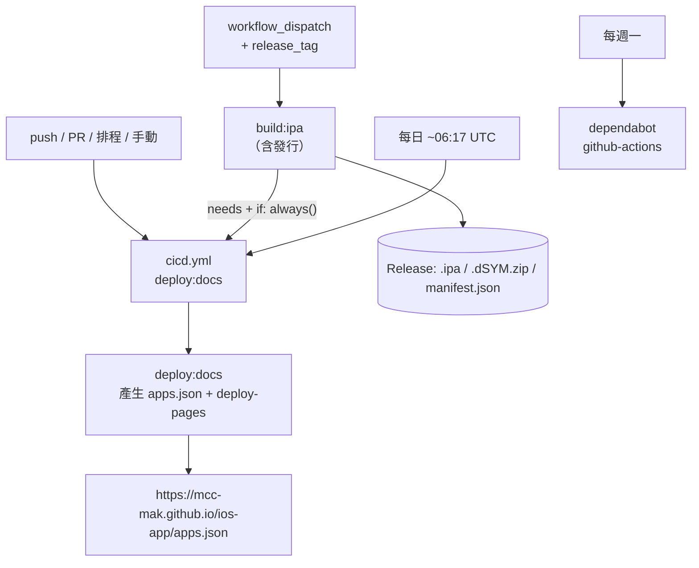
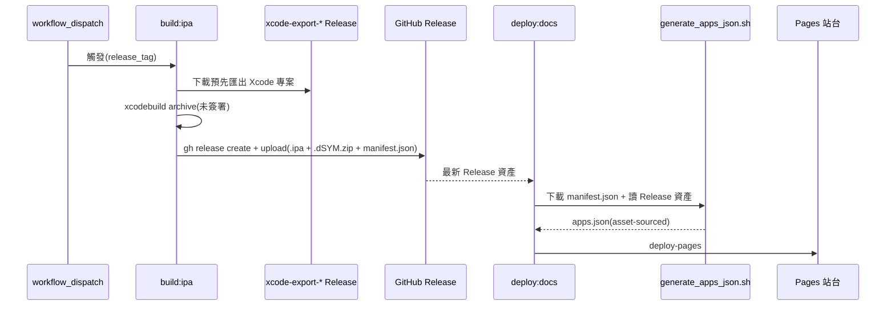
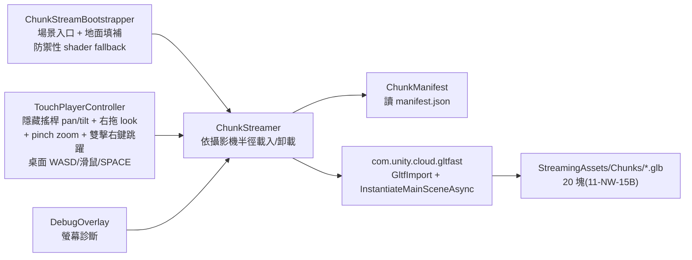

# 架構概觀

ios-app 是一套**零成本 iOS CI/CD pipeline**，以未簽署建置 + GitHub Release + GitHub Pages 饋流，支援免費 Apple ID 側載。全程僅用內建 `GITHUB_TOKEN`，無任何 Apple 機密。

## Pipeline 觸發與流程

> `test:sast` job 已移除（原始 Swift 測試 + CodeQL Swift 隨 Swift 專案刪除）。`build:ipa` 僅 `workflow_dispatch` 觸發，下載預先匯出的 Xcode 專案（`xcode-export-*` Release）後執行 `xcodebuild` 未簽署封存，並直接上傳資產至目標 Release（`release:ipa` 已併入）。`deploy:docs` 以 `needs: build` + `if: always()` 守護，在 build 為 `skipped` 時仍可部署文件。

## 資料流

建置物從 Xcode 流到使用者裝置，中繼資料全程 **asset-sourced**（取自實際建置物，非猜測）。

## 元件清單

| 元件 | 檔案 | 職責 |
| --- | --- | --- |
| 建置腳本 | `../codebase/scripts/build_unity_ipa.sh` | 三模式：預設全管線（Unity export + `xcodebuild` + 打包）、`UNITY_EXPORT_ONLY=1`（Windows 本機 Unity 匯出）、`XCODEBUILD_ONLY=1`（CI macOS，需 `XCODE_PROJECT_DIR`）。未簽署封存、打包 IPA（`Payload/` 在根目錄）、產出 dSYM.zip 與 manifest.json、驗證版面。 |
| Xcode 匯出腳本 | `../codebase/scripts/export_xcode_project.ps1` | 本機 Windows 以 Tuanjie 匯出 Xcode 專案；`-ChunksSource <dir>` 注入分塊資料至 StreamingAssets，打包為 `xcode-export-*` Release 供 CI 使用。 |
| 饋流產生器 | `../codebase/scripts/generate_apps_json.sh` | 從最新 Release 資產 + `app.config.json` 重建 AltStore/SideStore `apps.json`。 |
| 饋流設定 | `../codebase/app.config.json` | 饋流層級中繼資料（名稱、描述、網站、圖示、開發者）。 |
| Pages 入口網站 | `../codebase/site/index.html`, `style.css` | 靜態站台，client-side fetch `apps.json` 渲染最新版本與下載連結，並列出所有側載方式步驟。 |
| `build:ipa` | `../.github/workflows/cicd.yml` | **僅 `workflow_dispatch`**：下載 `xcode-export-*` Release 的 Xcode 專案 → `build_unity_ipa.sh`（`XCODEBUILD_ONLY=1`）未簽署封存 → 上傳 `unsigned-ipa` / `dsym` 成品 → 直接上傳資產至目標 `release_tag` Release（已併入 `release:ipa`）。權限 `contents: write`。 |
| `deploy:docs` | `../.github/workflows/cicd.yml` | `needs: build` + `if: always()`；暫存站台、產生 `apps.json`、`upload-pages-artifact` + `deploy-pages`。權限 `contents: read` + `actions: read` + `pages: write` + `id-token: write`。 |
| 健康檢查 | `cicd.yml` 每日排程 | 每日 cron 執行 `deploy:docs`，偵測 runner/Xcode 版本漂移。 |
| Dependabot | `../.github/dependabot.yml` | 僅 `github-actions` 生態系（`swift` 條目已移除），每週一更新。 |

**設計原則：** 未簽署四旗標每次必帶(ADR-001);版本/bundleID/大小/日期 asset-sourced(ADR-003);單一 workflow、多 job、固定 `階段:產物` 命名(ADR-005);僅 `GITHUB_TOKEN`、零 Apple 機密(ADR-006);以 Tuanjie 2022.3.61t15 + C# + glTFast 實作(ADR-009 / ADR-011);分塊 GLB 串流取代單一 GLB 打包(ADR-008 已取代)。

## App 場景架構

App 為 Tuanjie 2022.3.61t15 + C# + glTFast 的攝影測量飛覽，分塊串流載入 CSDI 真實網格：

| 元件 | 檔案 | 職責 |
| --- | --- | --- |
| 場景入口 | `../codebase/unity-project/Assets/Scripts/ChunkStreamBootstrapper.cs` | 場景啟動、地面填補、防禦性 shader fallback。 |
| 分塊串流核心 | `../codebase/unity-project/Assets/Scripts/ChunkStreamer.cs` | 依攝影機半徑載入/卸載鄰近分塊；`TimeBudgetPerFrameDeferAgent` 限制每幀載入預算；HK 座標（EPSG:2326 Z-up）正規化至本地原點並以 −90° X 旋轉轉 Y-up。 |
| 資料模型 | `../codebase/unity-project/Assets/Scripts/ChunkManifest.cs` | `manifest.json` 資料模型（chunk id、bbox、centroid、檔名、位元組數、三角面數、鄰居）。 |
| 設定 | `../codebase/unity-project/Assets/Scripts/ChunkStreamConfig.cs` | ScriptableObject 串流設定（載入半載入半徑、預算等）。 |
| 觸控玩家控制 | `../codebase/unity-project/Assets/Scripts/TouchPlayerController.cs` | 觸控：隱藏搖桿 pan/tilt + 右拖 look + pinch zoom + 雙擊右鍵跳躍；桌面 WASD/滑鼠/SPACE。 |
| 診斷覆蓋層 | `../codebase/unity-project/Assets/Scripts/DebugOverlay.cs` | 螢幕上診斷資訊。 |
| 分塊資料 | `../codebase/unity-project/Assets/StreamingAssets/Chunks/` | `manifest.json` + `.glb` 分塊（建置產物，由 Stage A 產生，gitignored；Xcode 匯出時經 `export_xcode_project.ps1 -ChunksSource` 注入）。 |

> **iOS shader stripping：** `BuildIOS.cs` 的 `EnsureGltfFastShadersIncluded()` 將 glTFast + `Standard` shaders 加入 GraphicsSettings Always Included Shaders（經 `GraphicsSettings.asset` 的 SerializedObject）。`link.xml` 保留 C# 組件但**不**保留 shader 資產，故需顯式納入，否則會出現藍屏錯誤。

## 關聯文件

- 決策理由:`./adr.md`
- 介面契約:`./api.md`　·　欄位綱要:`./schema.md`　·　實體關係:`./erd.md`
