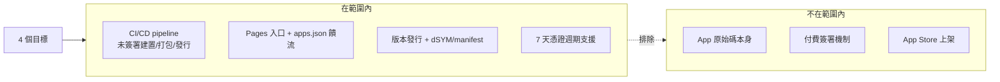

# 專案章程

## 目的

建立一套**零成本 iOS CI/CD pipeline**，讓持有免費 Apple ID 的使用者能透過 AltStore / SideStore / Sideloadly 側載安裝 App，無需付費 Apple Developer Program、憑證、provisioning profile 或 TestFlight。整套 pipeline 僅使用內建 `GITHUB_TOKEN`，可在未設定任何額外 secret 的 fork 上運作。

## 範圍

**在範圍內（In-scope）：**
- CI/CD pipeline：未簽署建置、封存、IPA 打包、發行。
- GitHub Pages 入口網站與 AltStore/SideStore `apps.json` 饋流。
- 版本發行（GitHub Release）與 dSYM / manifest.json 成品。
- 7 天憑證週期的重新安裝/刷新支援。

**不在範圍內（Out-of-scope）：**
- 任何付費簽署機制（certs、profiles、fastlane match）。
- App Store 上架。
- CI 內執行 Unity 建置（Unity 授權機密與 GameCI 重建待 ADR-010 / Stage C 後續評估；目前 CI 僅以預先匯出的 Xcode 專案執行 `xcodebuild`）。

## 目標

1. `push` 到 `main` 自動部署 Pages 入口與 `apps.json` 饋流；IPA 建置以 `workflow_dispatch` 指定 `release_tag` 觸發。
2. `workflow_dispatch` 觸發發行，自動產生 `.ipa` + `.dSYM.zip` + `manifest.json` 並上傳至目標 Release。
3. Pages 站台與 `apps.json` 在每次發行後自動更新。
4. Pipeline 在無任何 Apple 簽署機密的情況下完整運作（僅內建 `GITHUB_TOKEN`）。

## 成功標準

- `unzip -l "<App>-<Ver>.ipa"` 列出 `Payload/<App>.app/...` 位於 zip 根目錄。
- 全新 fork、零 secret 設定下，CI 全綠。
- `https://mcc-mak.github.io/ios-app/apps.json` 回傳符合 AltStore/SideStore schema 的有效饋流。
- 免費 Apple ID 使用者可透過 AltStore/SideStore 加入來源並安裝。

## 專案關係人

| 角色 | 身分 |
| --- | --- |
| 維護者 | Mcc-Mak（MIT license © 2026 Mcc-Mak） |
| 使用者 | 持有免費 Apple ID 的側載使用者 |
| 貢獻者 | 透過 PR 參與的開發者 |

## 時間表

專案狀態：**零成本 iOS CI/CD pipeline 與 HKGrid 體素 App 均已完整建置**（Tuanjie 2022.3.61t15 + C# + glTFast,見 `./adr.md` ADR-009 / ADR-011;專案位於 `../codebase/unity-project/`）。發行由 `workflow_dispatch` 觸發;目前版本見 `../CHANGELOG.md`,最新版本為 `v2.2.18`。
