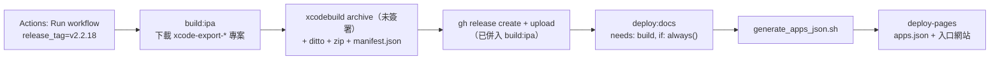

# CI/CD 參考

本文件說明單一工作流程 [`cicd.yml`](../.github/workflows/cicd.yml) 的 job、未簽署建置不變量、發行→部署鏈與 `apps.json` 重新產生機制。**v2.2.18 現況：** `test:sast` 已移除（原始 Swift 測試 + CodeQL Swift 隨 Swift 專案刪除），`release:ipa` 已併入 `build:ipa`，現存 `build:ipa`（僅 `workflow_dispatch`）與 `deploy:docs` 兩個 job。

## 未簽署建置不變量

**每一次 `xcodebuild`（archive）皆須帶齊四個旗標**，缺一即破壞免費 Apple ID sideload 前提：

```bash
CODE_SIGNING_ALLOWED=NO CODE_SIGNING_REQUIRED=NO CODE_SIGN_IDENTITY="" CODE_SIGN_ENTITLEMENTS=""
```

此規範由 `../AGENTS.md` 強制。`test:sast` job 已移除，故模擬器測試 destination 動態探勘邏輯暫不使用；待 Stage C 以 GameCI 重建測試 job 後再恢復（見 `./adr.md` ADR-010）。

## 單一工作流程與命名規範

`.github/workflows/` 只有一支 `cicd.yml`。**工作流程 `name:` 不含冒號**；每個 job 的顯示名稱固定為 `階段:產物`：

| Job key | 顯示名稱 | 用途 |
| --- | --- | --- |
| `build` | `build:ipa` | 未簽署 IPA / dSYM / `manifest.json` + 上傳至 Release（已併入 `release:ipa`） |
| `deploy` | `deploy:docs` | Pages 入口網站 + `apps.json` |
| ~~`test`~~ | ~~`test:sast`~~ | **已移除**（待 Stage C GameCI 重建） |
| ~~`release`~~ | ~~`release:ipa`~~ | **已併入 `build:ipa`** |

> GitHub Actions 的 job **key** 不能包含 `:`，因此冒號只出現在 `name:` 顯示名稱。新增階段時沿用 `階段:產物` 形式，並維持 `test → build → release → deploy` 順序（目前 test/release 暫缺）。

## 觸發條件

| 事件 | 行為 |
| --- | --- |
| `push` 至 `main` | `deploy:docs` |
| `pull_request` 至 `main` | `deploy:docs`（不發行、不建置 IPA） |
| 每日 cron `17 6 * * *` | 健康檢查：`deploy:docs`，不發布 |
| `workflow_dispatch`（含 `release_tag` 輸入） | `build:ipa` → `deploy:docs` |

`concurrency` 只在 `pull_request` 取消被取代的舊執行；`main` 與 `workflow_dispatch` 的執行（含 Pages 部署）不中斷。

## test:sast — 測試與靜態分析（已移除）

**v2.2.18：此 job 已刪除。** 原始 Swift 模擬器測試 + CodeQL Swift 分析隨原始 Swift 專案一併刪除——App 已遷移至 Tuanjie + C# + glTFast（ADR-009 / ADR-011）。Unity 測試待 Stage C 以 GameCI 重建（ADR-010）。重建後將恢復模擬器 destination 動態探勘與 `-enableCodeCoverage YES` 流程。

## build:ipa — 建置未簽署 IPA（含發行）

- **僅 `workflow_dispatch` 觸發**（`if: github.event_name == 'workflow_dispatch'`），需輸入 `release_tag`（semver `v*`）。**不在 `push` / `pull_request` / `schedule` 自動執行。**
- 下載預先匯出的 Xcode 專案：從 `xcode-export-*` Release 取得 tarball，解壓至 `XCODE_PROJECT_DIR`（CI 內不跑 Unity，故不需要 `UNITY_LICENSE` secret）。
- 呼叫 [`../codebase/scripts/build_unity_ipa.sh`](../codebase/scripts/build_unity_ipa.sh)（`XCODEBUILD_ONLY=1` 模式）：`xcodebuild archive`（未簽署）→ `ditto` 取出 `.app` → `Payload/<App>.app` 置於 zip 根目錄 → 產出 `.dSYM.zip` 與 `manifest.json`。
- 上傳 workflow 成品：`unsigned-ipa`（`.ipa` + `manifest.json`，保留 30 天）、`dsym`。
- **直接上傳資產至目標 Release**（原 `release:ipa` 已併入）：`gh release view` 判斷是否已存在；否則 `gh release create <release_tag> --title "<App> <Ver>" --generate-notes --verify-tag`；`gh release upload <release_tag> --clobber` 上傳 `.ipa`、`manifest.json`、`.dSYM.zip`（以 `nullglob` 收集，缺 dSYM 時不會傳入字面 glob）。
- 執行摘要會列出 App、版本、Bundle ID、IPA 檔名與 `releases/latest` 連結 —— 直接回答「IPA 在哪裡下載」。
- **權限**：`contents: write`。

## deploy:docs — 入口網站與饋流

- `needs: build`，`if: always()` 並檢查 `needs.build.result`（`success` 或 `skipped`）——`build:ipa` 在非 `workflow_dispatch` 事件為 `skipped`，`deploy:docs` 仍會執行以維護 Pages 與饋流。
- 只在 `push`、`pull_request`、`schedule` 與 `workflow_dispatch` 部署。
- job-level `concurrency: { group: pages, cancel-in-progress: false }`，避免並行部署互相覆蓋。
- **權限**：`contents: read`、`actions: read`、`pages: write`、`id-token: write`；`environment: github-pages`。
- 步驟：stage `codebase/site/` → `generate_apps_json.sh` → `actions/upload-pages-artifact@v3` → `actions/deploy-pages@v4`。

## 發行 → 部署觸發鏈



1. 於 GitHub Actions → `cicd.yml` → **Run workflow**，輸入 `release_tag`（如 `v2.2.18`）。
2. `build:ipa` 下載預先匯出的 Xcode 專案（`xcode-export-*` Release）→ `XCODEBUILD_ONLY=1` 模式執行 `build_unity_ipa.sh` 進行未簽署封存 → 建立/更新目標 Release 並上傳 `.ipa` / `.dSYM.zip` / `manifest.json`。
3. 同一 run 的 `deploy:docs`（`needs: build`、`if: always()`）在發行成功後執行，不需要 `gh workflow run` 交叉觸發。
4. `deploy:docs` 從最新 Release asset 取 `version` / `versionDate` / `size` / `downloadURL`，重新產生 `apps.json` 並部署。

## 為什麼入口網站曾顯示「尚無發行版本」

`apps.json` 的唯一資料來源是 **GitHub Release**，不是 CI 成品。儲存庫從未推送 `v*` 標籤時：

- 沒有 Release，`gh release list` 為空 → 產生器輸出合法的 `{ "apps": [] }`。
- 入口網站因此沒有版本可渲染（即使 Actions 已有成功的 `unsigned-ipa`）。

修正方式是發布版本（推送 `v*` 標籤），而非修改饋流。入口網站現在也會在空饋流時連到 `releases/latest` 並說明原因，不再出現無法點擊的按鈕。

## apps.json 重新產生

`generate_apps_json.sh` 以 `gh release view` 取得最新 Release，從 `manifest.json` 資產讀取 `version`/`bundleIdentifier`/`appName`（fallback 至 tag 與 `app.config.json`），`size` 取自 asset、`versionDate` 取自 `publishedAt`、`downloadURL` 由 tag + asset 名稱組裝（**皆資產來源，非猜測**），合併 `app.config.json` 的饋流層級中繼資料，寫入 `_site/apps.json`。每筆 app 條目至少含：`name`、`bundleIdentifier`、`version`、`versionDate`（ISO 8601）、`downloadURL`、`size`（bytes）。無發行版本時輸出 `apps:[]` 的合法 JSON。

## 每日健康檢查

`cicd.yml` 的 `schedule` 事件會執行 `deploy:docs`（build 為 `skipped`），用途是保持 Pages 入口與 `apps.json` 饋流新鮮，並及早發現 `ubuntu-latest` 映像、`actions/deploy-pages` 或 `generate_apps_json.sh` 漂移；不建立 Release，也不執行 `xcodebuild`。`build:ipa` 不在排程自動執行（`workflow_dispatch` only，避免無謂的 Xcode 建置消耗 runner 額度）。

相關檔案：`../.github/workflows/cicd.yml`、`../codebase/scripts/build_unity_ipa.sh`、`../codebase/scripts/export_xcode_project.ps1`、`../codebase/scripts/generate_apps_json.sh`、`../codebase/site/`、`../codebase/app.config.json`。