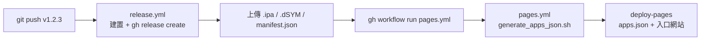

# CI/CD 參考

本文件詳述五個 workflow 的運作邏輯、未簽署建置不變量、release→pages 觸發鏈與 `apps.json` 重新產生機制。

## 未簽署建置不變量

**每一次 `xcodebuild`（test / build / archive）皆須帶齊四個旗標**，缺一即破壞免費 Apple ID sideload 前提：

```bash
CODE_SIGNING_ALLOWED=NO CODE_SIGNING_REQUIRED=NO CODE_SIGN_IDENTITY="" CODE_SIGN_ENTITLEMENTS=""
```

此規範由 `../AGENTS.md` 強制。模擬器測試 destination 範例：

```bash
-destination 'platform=iOS Simulator,name=iPhone 15,OS=latest'
```

## ci.yml — 測試 + 建置 IPA

- **檔案**：`../.github/workflows/ci.yml`
- **觸發**：`push` / `pull_request` 到 `main`；`concurrency` 取消被覆蓋的舊 run。
- **Runner**：`macos-latest`，以 `maxim-lobanov/setup-xcode` 指定 Xcode。
- **test job**：`xcodebuild test` 於 iOS Simulator，`-enableCodeCoverage YES`，再以 `xcrun xccov view --report --json <path.xcresult>` 匯出覆蓋率。
- **build-ipa job**：呼叫 `../codebase/scripts/build_unsigned_ipa.sh`，以 `ditto` 打包 `.app`、確保 `Payload/<App>.app` 在 zip 根目錄，產出 IPA + dSYM + `manifest.json`。
- **上傳成品**：`actions/upload-artifact` 上傳 `.ipa`、`.dSYM.zip`、`manifest.json`。

## release.yml — 發行版本

- **檔案**：`../.github/workflows/release.yml`
- **觸發**：`push` tag `v*`（semver `vX.X.X`）。
- **步驟**：建置 IPA → `gh release create --generate-notes --verify-tag <tag>` → 上傳 `.ipa` + `.dSYM` + `manifest.json` → `gh workflow run pages.yml` 觸發 Pages 重建。
- **產出**：GitHub Release 與其 asset；Release asset 為 `apps.json` 的唯一資料來源。

## pages.yml — 部署 Pages 入口與 feed

- **檔案**：`../.github/workflows/pages.yml`
- **觸發**：`push` 到 `codebase/site/` 或 `codebase/app.config.json`；`workflow_dispatch`；由 `release.yml` 以 `gh workflow run` 觸發。
- **權限**：`pages: write`、`id-token: write`；`environment: github-pages`。
- **步驟**：stage `codebase/site/` → 執行 `../codebase/scripts/generate_apps_json.sh` → `actions/upload-pages-artifact` → `actions/deploy-pages`。
- **產出**：https://mcc-mak.github.io/ios-app/ 與 `apps.json`。

## codeql.yml — 靜態分析

- **檔案**：`../.github/workflows/codeql.yml`
- **觸發**：`push` / `pull_request` 到 `main`；每週排程。
- **步驟**：`config-mode: manual`、語言 Swift；**先執行未簽署建置讓 CodeQL 能儀器化編譯**，再進行分析。

## health.yml — 每日健康檢查

- **檔案**：`../.github/workflows/health.yml`
- **觸發**：每日 cron `17 6 * * *`。
- **步驟**：對 `main` 執行未簽署建置，及早發現 runner / Xcode 版本漂移。

## release → pages 觸發鏈



1. `git push origin v1.2.3` → `release.yml` 建 Release。
2. `release.yml` 結尾 `gh workflow run pages.yml`。
3. `pages.yml` 從最新 Release asset 取 `version` / `versionDate` / `size` / `downloadURL`，重新產生 `apps.json` 並部署。

## apps.json 重新產生

`generate_apps_json.sh` 以 `gh release view` 取得最新 Release，從 `manifest.json` 資產讀取 `version`/`bundleIdentifier`/`appName`（fallback 至 tag 與 `app.config.json`），`size` 取自 asset、`versionDate` 取自 `publishedAt`、`downloadURL` 由 tag + asset 名稱組裝（**皆資產來源，非猜測**），合併 `app.config.json` 的饋流層級中繼資料，寫入 `codebase/site/apps.json`。每筆 app 條目至少含：`name`、`bundleIdentifier`、`version`、`versionDate`（ISO 8601）、`downloadURL`、`size`（bytes）。無發行版本時輸出 `apps:[]` 的合法 JSON。

相關檔案：`../codebase/scripts/build_unsigned_ipa.sh`、`../codebase/scripts/generate_apps_json.sh`、`../codebase/site/`、`../codebase/app.config.json`。
