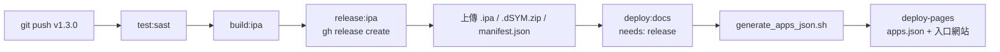

# CI/CD 參考

本文件說明單一工作流程 [`cicd.yml`](../.github/workflows/cicd.yml) 的四個 job、未簽署建置不變量、發行→部署鏈與 `apps.json` 重新產生機制。

## 未簽署建置不變量

**每一次 `xcodebuild`（test / build / archive）皆須帶齊四個旗標**，缺一即破壞免費 Apple ID sideload 前提：

```bash
CODE_SIGNING_ALLOWED=NO CODE_SIGNING_REQUIRED=NO CODE_SIGN_IDENTITY="" CODE_SIGN_ENTITLEMENTS=""
```

此規範由 `../AGENTS.md` 強制。測試 destination 不使用固定機型名稱，而是動態探勘可用的 iPhone 模擬器 UDID：

```bash
sim_udid=$(xcrun simctl list devices available -j | python3 -c "import json,sys; d=json.load(sys.stdin); print(next((dev['udid'] for rt,devs in d['devices'].items() for dev in devs if 'iPhone' in dev.get('name','') and dev.get('isAvailable')), ''))")
xcodebuild test -destination "id=$sim_udid" ...
```

## 單一工作流程與命名規範

`.github/workflows/` 只有一支 `cicd.yml`。**工作流程 `name:` 不含冒號**；每個 job 的顯示名稱固定為 `階段:產物`：

| Job key | 顯示名稱 | 用途 |
| --- | --- | --- |
| `test` | `test:sast` | 模擬器測試 + 覆蓋率 + CodeQL Swift |
| `build` | `build:ipa` | 未簽署 IPA / dSYM / `manifest.json` |
| `release` | `release:ipa` | `v*` 標籤 → GitHub Release |
| `deploy` | `deploy:docs` | Pages 入口網站 + `apps.json` |

> GitHub Actions 的 job **key** 不能包含 `:`，因此冒號只出現在 `name:` 顯示名稱。新增階段時沿用 `階段:產物` 形式，並維持 `test → build → release → deploy` 順序。

## 觸發條件

| 事件 | 行為 |
| --- | --- |
| `push` 至 `main` | `test:sast` → `build:ipa` → `deploy:docs` |
| `push` 標籤 `v*` | `test:sast` → `build:ipa` → `release:ipa` → `deploy:docs` |
| `pull_request` 至 `main` | `test:sast` → `build:ipa`（不發行、不部署） |
| 每日 cron `17 6 * * *` | 健康檢查：`test:sast` → `build:ipa`，不發布 |
| `workflow_dispatch` | 依所選 ref 執行 |

`concurrency` 只在 `pull_request` 取消被取代的舊執行；`main` 與標籤的執行（含 Pages 部署）不中斷。

## test:sast — 測試與靜態分析

- **Runner**：`macos-latest`，以 `maxim-lobanov/setup-xcode` 指定 `latest-stable`。
- **測試**：`xcodebuild test` 於 iOS Simulator，`-enableCodeCoverage YES`，再以 `xcrun xccov view --report --json <path.xcresult>` 匯出覆蓋率；`test-results` 成品保留 14 天。
- **SAST**：`github/codeql-action/init@v4`（`languages: swift`、`build-mode: manual`）→ 執行 `build_unsigned_ipa.sh` 讓 CodeQL 儀器化編譯 → `analyze@v4`。
- **順序注意**：測試成品必須在 CodeQL 建置<strong>之前</strong>上傳，因為建置腳本會清除 `build/`。
- **略過條件**：Dependabot PR（權杖唯讀）與外部 fork PR 不執行 CodeQL，避免 `security-events: write` 不可用而失敗；測試仍照常執行。
- **權限**：`contents: read` + `security-events: write`。

## build:ipa — 建置未簽署 IPA

- `needs: test`：測試失敗即不建置、不發行。
- 呼叫 [`../codebase/scripts/build_unsigned_ipa.sh`](../codebase/scripts/build_unsigned_ipa.sh)：`xcodebuild archive`（未簽署）→ `ditto` 取出 `.app` → `Payload/<App>.app` 置於 zip 根目錄 → 產出 `.dSYM.zip` 與 `manifest.json`。
- 上傳成品：`unsigned-ipa`（`.ipa` + `manifest.json`，保留 30 天）、`dsym`、`test-results`。
- 執行摘要會列出 App、版本、Bundle ID、IPA 檔名與 `releases/latest` 連結 —— 直接回答「IPA 在哪裡下載」。

## release:ipa — 發行版本

- `needs: build`，`if: startsWith(github.ref, 'refs/tags/v')`，runner 為 `ubuntu-latest`。
- 以 `actions/download-artifact@v4` 取回 `unsigned-ipa` 與 `dsym`（dSYM 不存在時該步允許失敗）。
- `gh release view` 判斷是否已存在；否則 `gh release create <tag> --title "<App> <Ver>" --generate-notes --verify-tag`。
- `gh release upload <tag> --clobber` 上傳 `.ipa`、`manifest.json`、`.dSYM.zip`（以 `nullglob` 收集，缺 dSYM 時不會傳入字面 glob）。
- **權限**：僅 `contents: write`。

## deploy:docs — 入口網站與饋流

- `needs: [build, release]`，`if: always()` 並檢查 `needs.build.result == 'success'` 與 `needs.release.result`（`success` 或 `skipped`）。
- 只在 `push` 與 `workflow_dispatch` 部署；PR 不部署。
- job-level `concurrency: { group: pages, cancel-in-progress: false }`，避免並行部署互相覆蓋。
- **權限**：`contents: read`、`pages: write`、`id-token: write`；`environment: github-pages`。
- 步驟：stage `codebase/site/` → `generate_apps_json.sh` → `actions/upload-pages-artifact@v3` → `actions/deploy-pages@v4`。

## 發行 → 部署觸發鏈



1. `git push origin v1.3.0` → `test:sast` 通過。
2. `build:ipa` 上傳成品 → `release:ipa` 建立 Release 並附加資產。
3. 同一 run 的 `deploy:docs`（`needs: [build, release]`）在發行成功後執行，不需要 `gh workflow run` 交叉觸發。
4. `deploy:docs` 從最新 Release asset 取 `version` / `versionDate` / `size` / `downloadURL`，重新產生 `apps.json` 並部署。

## 為什麼入口網站曾顯示「尚無發行版本」

`apps.json` 的唯一資料來源是 **GitHub Release**，不是 CI 成品。儲存庫從未推送 `v*` 標籤時：

- 沒有 Release，`gh release list` 為空 → 產生器輸出合法的 `{ "apps": [] }`。
- 入口網站因此沒有版本可渲染（即使 Actions 已有成功的 `unsigned-ipa`）。

修正方式是發布版本（推送 `v*` 標籤），而非修改饋流。入口網站現在也會在空饋流時連到 `releases/latest` 並說明原因，不再出現無法點擊的按鈕。

## apps.json 重新產生

`generate_apps_json.sh` 以 `gh release view` 取得最新 Release，從 `manifest.json` 資產讀取 `version`/`bundleIdentifier`/`appName`（fallback 至 tag 與 `app.config.json`），`size` 取自 asset、`versionDate` 取自 `publishedAt`、`downloadURL` 由 tag + asset 名稱組裝（**皆資產來源，非猜測**），合併 `app.config.json` 的饋流層級中繼資料，寫入 `_site/apps.json`。每筆 app 條目至少含：`name`、`bundleIdentifier`、`version`、`versionDate`（ISO 8601）、`downloadURL`、`size`（bytes）。無發行版本時輸出 `apps:[]` 的合法 JSON。

## 每日健康檢查

`cicd.yml` 的 `schedule` 事件會執行 `test:sast` → `build:ipa`，用途是及早發現 `macos-latest` 映像或 `latest-stable` Xcode 漂移；不建立 Release，也不部署 Pages。

相關檔案：`../.github/workflows/cicd.yml`、`../codebase/scripts/build_unsigned_ipa.sh`、`../codebase/scripts/generate_apps_json.sh`、`../codebase/site/`、`../codebase/app.config.json`。