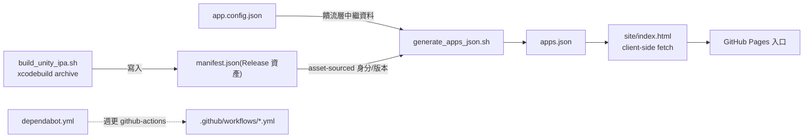

# 設定參考

本文件彙整所有設定檔、環境變數與 workflow 觸發條件。Pipeline 僅用內建 `GITHUB_TOKEN`，**零 Apple 機密**（無憑證、無 provisioning profile、無 App Store Connect key；fork 後零設定即可運作）。

## 設定檔總覽

| 路徑 | 用途 | 關鍵欄位 |
|------|------|---------|
| `../codebase/app.config.json` | AltStore/SideStore feed metadata | `name`、`subtitle`、`description`、`website`、`iconURL`、`appName`、`bundleIdentifier`、`developerName` |
| `../.github/dependabot.yml` | 依賴更新 | `ecosystems: github-actions`（`swift` 條目已移除）；`schedule: weekly`（週一） |
| `../.gitignore` | 忽略建置產物 | `build/`、`*.ipa`、`*.dSYM.zip`、`DerivedData/`、`*.xcuserstate`、`codebase/unity-project/Assets/StreamingAssets/Chunks/` |
| `../AGENTS.md` | agent 規範 | hard constraints、workflow 規範、IPA 布局規則 |

## `build_unity_ipa.sh` 環境變數覆寫

| 變數 | 預設 | 說明 |
|------|------|------|
| `SCHEME` / `PROJECT` / `WORKSPACE` | 自動探勘 | 指定 scheme / `.xcodeproj` / `.xcworkspace` |
| `XCODE_PROJECT_DIR` | — | `XCODEBUILD_ONLY=1` 模式下的 Xcode 專案目錄（CI 必填） |
| `UNITY_EXPORT_ONLY` | `0` | `=1` 僅 Unity 匯出 Xcode 專案（Windows 本機） |
| `XCODEBUILD_ONLY` | `0` | `=1` 僅 `xcodebuild` + 打包（CI macOS，需 `XCODE_PROJECT_DIR`） |
| `IPA_NAME` / `DSYM_NAME` | `<App>-<Ver>` | 輸出檔名 |
| `CONFIGURATION` | `Release` | xcodebuild configuration |
| `ARCHIVE_DIR` | `build` | archive 輸出根目錄 |

`manifest.json` 欄位（資產來源中繼資料）：`appName`、`bundleIdentifier`、`version`、`ipaFileName`、`dsymFileName`、`ipaSizeBytes`、`minIOSVersion`，皆由 `Info.plist` 推導。

腳本寫入 `GITHUB_OUTPUT` 的鍵：`ipa-path`、`dsym-path`、`manifest-path`、`app-name`、`app-version`、`bundle-id`、`ipa-file-name`、`dsym-file-name`。

## `generate_apps_json.sh` 環境變數

| 變數 | 必要 | 說明 |
|------|------|------|
| `GITHUB_REPOSITORY` | 是 | `owner/repo` |
| `GITHUB_TOKEN` | 是 | 內建 token，查詢 Release asset |
| `APP_CONFIG` | 否 | 指向 `app.config.json`；腳本預設 `app.config.json`，`deploy:docs` 會傳入 `codebase/app.config.json` |

用法：`generate_apps_json.sh [output_path] [config_path]`；需 `gh` + `jq`（`GH_TOKEN` 或 `GITHUB_TOKEN`）。

## Workflow 觸發條件

| Job（`cicd.yml`） | 觸發 | Runner |
|----------|------|--------|
| `build:ipa` | **僅 `workflow_dispatch`**（指定 `release_tag`）；下載 `xcode-export-*` Release 的預先匯出 Xcode 專案，`XCODEBUILD_ONLY=1` 模式執行 `xcodebuild`，並直接上傳資產至目標 Release | `macos-latest` |
| `deploy:docs` | `push` / `pull_request` / 每日排程 / `workflow_dispatch`；`needs: build` + `if: always()`（build 為 `skipped` 時仍部署） | `ubuntu-latest` |
| ~~`test:sast`~~ | **已移除**（原始 Swift 測試 + CodeQL Swift 隨 Swift 專案刪除；待 Stage C GameCI 重建） | — |
| ~~`release:ipa`~~ | **已併入 `build:ipa`** | — |
| Dependabot | 每週一（僅 `github-actions`） | n/a |

相關檔案：`../codebase/scripts/build_unity_ipa.sh`、`../codebase/scripts/export_xcode_project.ps1`、`../codebase/scripts/generate_apps_json.sh`、`../codebase/app.config.json`、`../.github/dependabot.yml`、`../AGENTS.md`。
