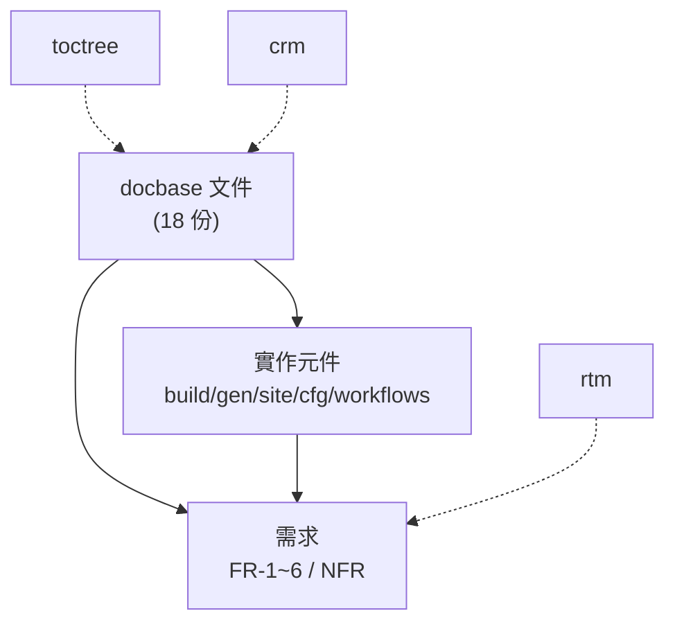

# 交叉參考矩陣 (CRM)

本矩陣呈現各 docbase 文件對元件 / 檔案的引用關係，以及各文件涵蓋的需求。用於檢查文件與實作、需求的雙向涵蓋。

**圖例**：`✓` = 該文件直接引用或涵蓋；`·` = 無直接引用。

## 表一：文件 × 元件

元件欄簡寫：`build`=build_unsigned_ipa.sh、`gen`=generate_apps_json.sh、`site`=site/、`cfg`=app.config.json，其餘為 workflow 檔名。

| 文件 | build | gen | site | cfg | ci.yml | release.yml | pages.yml | codeql.yml | health.yml | dependabot.yml |
|------|:--:|:--:|:--:|:--:|:--:|:--:|:--:|:--:|:--:|:--:|
| toctree | · | · | · | · | · | · | · | · | · | · |
| charter | · | · | · | · | ✓ | ✓ | ✓ | · | · | · |
| srs | · | · | · | · | · | · | · | · | · | · |
| pdr | ✓ | ✓ | · | · | ✓ | ✓ | ✓ | · | · | · |
| prd | · | · | ✓ | · | · | · | · | · | · | · |
| user-stories | · | · | · | · | · | · | · | · | · | · |
| adr | ✓ | · | · | · | ✓ | ✓ | ✓ | · | · | · |
| architecture | ✓ | ✓ | ✓ | ✓ | ✓ | ✓ | ✓ | ✓ | ✓ | ✓ |
| api | · | · | · | · | · | · | · | · | · | · |
| uiux | · | · | ✓ | · | · | · | · | · | · | · |
| schema | · | · | ✓ | ✓ | · | · | · | · | · | · |
| erd | · | · | ✓ | ✓ | · | · | · | · | · | · |
| setup | ✓ | ✓ | ✓ | · | · | ✓ | ✓ | · | · | · |
| configurations | ✓ | ✓ | · | ✓ | ✓ | ✓ | ✓ | ✓ | ✓ | ✓ |
| cicd | ✓ | ✓ | ✓ | ✓ | ✓ | ✓ | ✓ | ✓ | ✓ | · |
| rtm | ✓ | ✓ | ✓ | · | ✓ | ✓ | ✓ | ✓ | ✓ | ✓ |
| crm | ✓ | ✓ | ✓ | ✓ | ✓ | ✓ | ✓ | ✓ | ✓ | ✓ |
| quick-start | · | · | ✓ | · | ✓ | ✓ | ✓ | · | · | · |

## 表二：文件 × 需求

`NFR` 欄涵蓋 NFR-1（零機密）/ NFR-2（確定性打包）/ NFR-3（7 天週期）/ NFR-4（可重現建置）任一項。

| 文件 | FR-1 | FR-2 | FR-3 | FR-4 | FR-5 | FR-6 | NFR |
|------|:--:|:--:|:--:|:--:|:--:|:--:|:--:|
| toctree | · | · | · | · | · | · | · |
| charter | · | · | · | · | · | · | ✓ |
| srs | ✓ | ✓ | ✓ | ✓ | ✓ | ✓ | ✓ |
| pdr | · | ✓ | · | ✓ | ✓ | · | · |
| prd | ✓ | ✓ | ✓ | ✓ | ✓ | ✓ | · |
| user-stories | ✓ | ✓ | ✓ | ✓ | ✓ | ✓ | · |
| adr | · | · | · | · | · | · | ✓ |
| architecture | ✓ | ✓ | ✓ | ✓ | ✓ | ✓ | ✓ |
| api | · | · | · | · | · | · | · |
| uiux | · | · | · | · | ✓ | · | · |
| schema | · | · | · | · | ✓ | · | · |
| erd | · | · | · | · | ✓ | · | · |
| setup | · | ✓ | · | ✓ | ✓ | · | · |
| configurations | · | ✓ | · | ✓ | ✓ | ✓ | ✓ |
| cicd | ✓ | ✓ | ✓ | ✓ | ✓ | ✓ | ✓ |
| rtm | ✓ | ✓ | ✓ | ✓ | ✓ | ✓ | ✓ |
| crm | ✓ | ✓ | ✓ | ✓ | ✓ | ✓ | ✓ |
| quick-start | · | ✓ | · | ✓ | ✓ | · | ✓ |

## 涵蓋觀察

- 所有元件至少被 `architecture`、`crm` 兩份文件引用。
- 所有 FR/NFR 至少被 `srs`、`architecture`、`cicd`、`rtm`、`crm` 涵蓋，無遺漏。
- `api` 因本專案無對外 API，故無引用。

相關檔案：`../codebase/`、`../.github/workflows/`。
