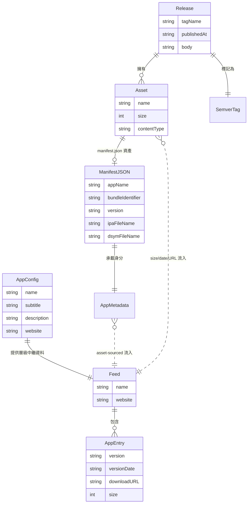

# 實體關係圖

ios-app 無資料庫；本圖描述檔案式「資料模型」中概念實體之間的關聯，涵蓋發行、成品、中繼資料、設定與饋流。

## ERD

## 實體與基數

| 實體 | 說明 | 實際載體 |
| --- | --- | --- |
| **Release** | 一個 `v*` semver tag 對應一個 GitHub Release。 | GitHub Release |
| **Asset** | Release 附帶的檔案。 | `<App>-<Ver>.ipa`、`<App>-<Ver>.dSYM.zip`、`manifest.json` |
| **App Metadata** | 由 `manifest.json` 資產承載的 App 身分。 | `manifest.json` |
| **semver Tag** | 發行標籤，解析為 `version`。 | git tag `vX.X.X` |
| **App Config** | 饋流層中繼資料設定。 | `../codebase/app.config.json` |
| **Feed** | AltStore/SideStore 來源饋流。 | `apps.json` |
| **App Entry** | 饋流中單一 App 條目。 | `apps.json` 的 `apps[]` 一項 |

## 關鍵關係

- **Release (1) — (\*) Asset：** 一個發行版本擁有多個資產（IPA、dSYM、manifest）。
- **Asset — (1) manifest.json：** manifest.json 本身是一個資產；它承載 App 身分（`appName`/`bundleIdentifier`/`version`/檔名）。
- **manifest.json — App Metadata：** manifest.json **提供** App 身分給饋流產生器（asset-sourced），避免猜測。
- **Release tag — (1) semver version：** 標籤 `vX.X.X` 對應版本 `X.X.X`；作為 `version` 的 fallback。
- **App Config (1) — (1) Feed：** 一份設定產生一份饋流的層級中繼資料。
- **Feed (1) — (\*) App Entry：** 一份饋流可含多個 App 條目（本專案目前為單一 App，但 schema 支援多個）。
- **Asset → Feed（asset-sourced 邊）：** `version`/`versionDate`/`size`/`downloadURL` 由 Release 資產 + manifest.json 流入饋流產生器（見 `./schema.md` 硬性規則）。

## 關聯文件

- 欄位綱要：`./schema.md`　·　介面契約：`./api.md`　·　架構與資料流：`./architecture.md`
