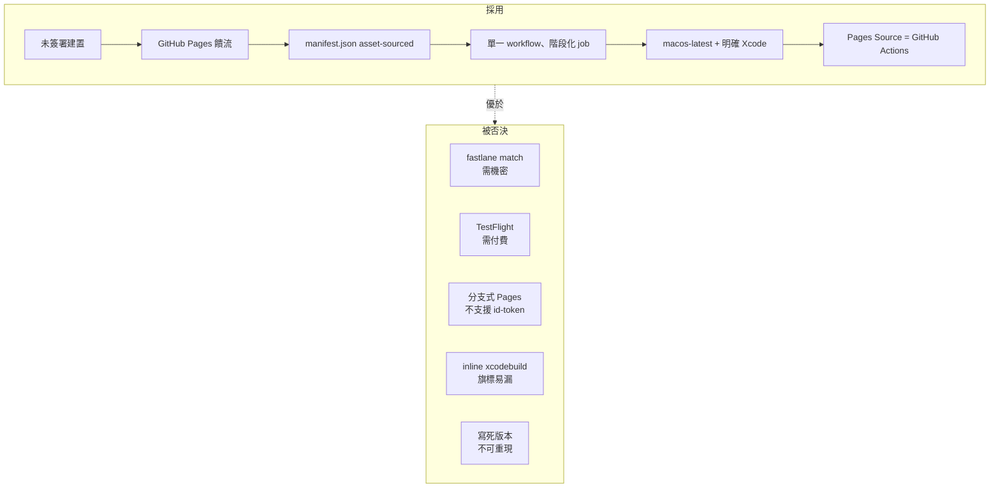

# 初步設計審查（PDR）

本文件記錄 ios-app pipeline 的關鍵設計決策、理由、取捨與被否決的替代方案。硬性限制見 `../AGENTS.md`。

## 關鍵設計決策

| 決策 | 理由 |
| --- | --- |
| **未簽署建置** | 免費 Apple ID 無法在 CI 產生可安裝安裝簽署；簽署交由使用者的 Sideloadly/AltStore/SideStore 完成。所有 `xcodebuild`（test/build/archive）皆帶四個未簽署旗標。 |
| **GitHub Pages 作為饋流來源** | 免費、與 repo 同源、`actions/deploy-pages` 一鍵部署；`apps.json` 固定 URL `https://mcc-mak.github.io/ios-app/apps.json`，符合 AltStore/SideStore source spec。 |
| **資產來源中介資料（manifest.json）** | Release asset 的檔名/版本由建置時寫入 `manifest.json` 並隨 Release 發布；`generate_apps_json.sh` 以此填入 `apps.json`，避免猜測或二次剖析。 |
| **單一工作流程、階段化 job** | 以一支 `cicd.yml` 依序 `test:sast` → `build:ipa` → `release:ipa` → `deploy:docs`，用 `needs` + artifacts 串接；避免跨 workflow 的 `gh workflow run` 與重複建置，同時保留各 job 的最小權限。 |
| **macos-latest + 明確 Xcode 選定** | iOS 建置僅能在 macOS runner 上進行；明確選 Xcode 版本可避免 runner 預設漂移導致的可重現性問題。 |
| **Pages Source = GitHub Actions** | 現代部署流程需 `permissions: { pages: write, id-token: write }` + `environment: github-pages`，非分支部署。 |

## 取捨

- **簡單 vs. 彈性**：腳本自動發現 `.xcodeproj`/`.xcworkspace` + scheme，但**發現超過一個即 fail-fast**，寧可失敗也不猜測。
- **即時 vs. 快取**：不引入複雜簽署快取，換取零機密與可重現。

## 被否決的替代方案

| 替代方案 | 否決理由 |
| --- | --- |
| fastlane match | 需要儲存 certs/profiles 的 repo 或 secret，違反「零 Apple 機密」硬性限制。 |
| TestFlight | 需付費 Apple Developer Program，違反「零成本」目的。 |
| 分支式 Pages 部署 | 不支援 `actions/deploy-pages` 的 id-token 部署流程；現代流程要求 Source = GitHub Actions。 |
| 在 workflow 內 inline `xcodebuild` | 重複邏輯、易在各 stage 漏掉未簽署旗標；改為重用單一腳本。 |
| 寫死 App 名稱/版本 | 版本變動需改腳本；改由 built `Info.plist` 推導。 |
