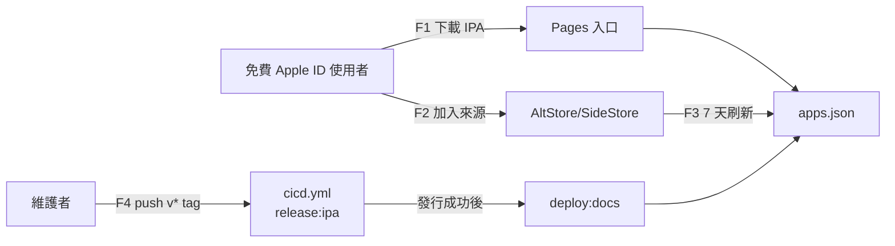

# 產品需求文件（PRD）

本專案的「產品」是**側載發行系統**本身——讓免費 Apple ID 使用者能持續取得並刷新 App，而非 App 原始碼。硬性限制見 `../AGENTS.md`。

## 角色（Personas）

| 角色 | 描述 | 主要目標 |
| --- | --- | --- |
| 免費 Apple ID 使用者 | 無付費開發者帳號，欲側載安裝 App。 | 一鍵下載/安裝、7 天後自動刷新。 |
| 維護者 | Mcc-Mak 及貢獻者。 | 以 tag 觸發發行、監控 pipeline 健康。 |

## 使用者面向功能與驗收標準

### F1：下載最新 IPA
- **說明**：使用者可從 Pages 入口或 GitHub Release 取得最新 `.ipa`；入口網站亦列出所有側載方式的完整步驟。
- **驗收條件**：`../codebase/site/index.html` 顯示最新版本與下載按鈕；下載連結指向 `https://github.com/Mcc-Mak/ios-app/releases/download/<tag>/<App>-<Ver>.ipa`；饋流為空時按鈕仍連到 `releases/latest` 並說明原因。

### F2：加入 AltStore/SideStore 來源
- **說明**：使用者將 `apps.json` URL 加入 AltStore/SideStore 即可安裝並接收更新。
- **驗收條件**：`https://mcc-mak.github.io/ios-app/apps.json` 回傳符合 schema 的有效饋流；欄位 `version`/`versionDate`/`size`/`downloadURL` 來自實際 Release asset。

### F3：7 天自動更新
- **說明**：免費憑證每 7 天到期；AltStore/SideStore 透過饋流重新整理/重新安裝。
- **驗收條件**：每次發行後 `apps.json` 的 `versionDate` 更新；使用者於 AltStore/SideStore 點刷新即可取得最新版。

### F4：發行版本自動產生
- **說明**：維護者推送 `v*` semver tag，pipeline 自動建置並發行。
- **驗收條件**：`../.github/workflows/cicd.yml` 的 `release:ipa` 建立 Release，附掛 `.ipa` + `.dSYM.zip` + `manifest.json`；同一次執行的 `deploy:docs` 在發行成功後重建饋流。

## v1.0.0 發行標準（Release Criteria）

- [ ] 六個 FR 全數實作並通過（見 `./srs.md`）。
- [ ] 全新 fork、零 secret 設定下，push/PR CI 全綠。
- [ ] `unzip -l` 驗證 IPA 佈局為 `Payload/<App>.app` 根目錄。
- [ ] Pages 站台上線，`apps.json` 有效且資產來源欄位正確。
- [ ] `../CHANGELOG.md` 記錄 `v1.0.0`。
