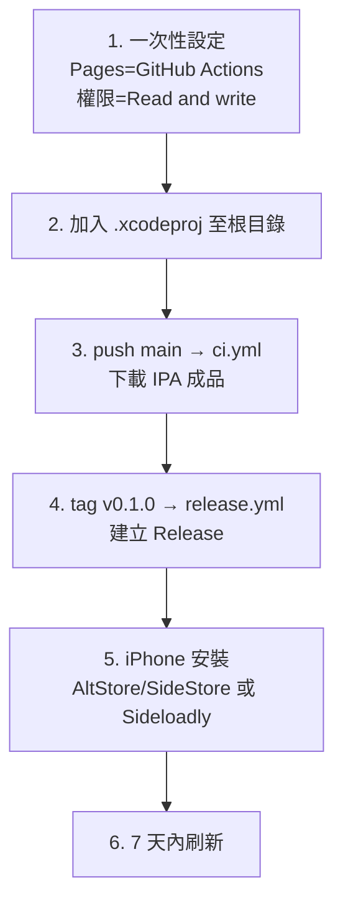

# 快速入門

5 分鐘從零到 iPhone 上 sideload。前提：repo 已 fork/clone 至本機，已安裝 Xcode + `gh`。



## 1. 一次性 repo 設定

在 GitHub `Mcc-Mak/ios-app` 設定兩項（只需一次）：

- **Settings → Pages → Source = GitHub Actions**
- **Settings → Actions → General → Workflow permissions = Read and write**

無需新增任何 secret；pipeline 僅用內建 `GITHUB_TOKEN`。

## 2. 加入 Xcode 專案

將 `.xcodeproj` 放在 repo 根目錄（與 `codebase/` 同層）。`build_unsigned_ipa.sh` 會自動探勘；根目錄保持僅一個專案，否則 fail fast。

## 3. 推到 main 觸發 CI

```bash
git add .
git commit -m "Add Xcode project"
git push origin main
```

`../.github/workflows/ci.yml` 隨即執行：模擬器測試 + 建置未簽署 IPA。到 **Actions → 該 run → Artifacts** 下載 `.ipa`。

## 4. 發行首版

```bash
git tag v0.1.0
git push origin v0.1.0
```

`../.github/workflows/release.yml` 觸發：建置 IPA → 建立 GitHub Release（`--generate-notes --verify-tag`）→ 上傳 `.ipa` + `.dSYM` + `manifest.json` → 觸發 `pages.yml` 重新產生 `apps.json`。

## 5. 在 iPhone 安裝

二擇一：

- **AltStore / SideStore**：加入來源 `https://mcc-mak.github.io/ios-app/apps.json`，即可看到 app 並安裝/刷新。
- **Sideloadly**：從 Release 頁下載 `.ipa`，以 Sideloadly + 免費 Apple ID sideload。

## 6. 7 天內刷新

免費 Apple ID sideload 憑證每 7 天過期。透過 AltStore/SideStore feed 一鍵刷新，或重新 sideload 同一個 Release `.ipa`（URL 固定不變）。

---

完成後可參考 `setup.md`（本機開發）、`configurations.md`（設定）、`cicd.md`（workflow 細節）。
