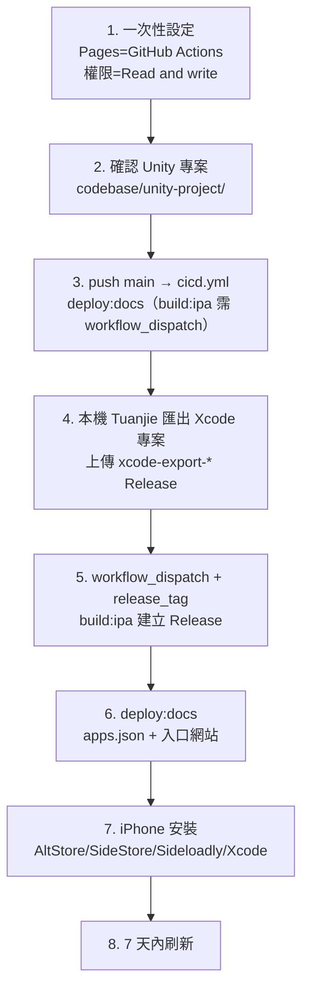

# 快速入門

5 分鐘從零到 iPhone 上 sideload。前提：repo 已 fork/clone 至本機，已安裝 Xcode + `gh`；首次建置另需 Windows + Tuanjie 匯出 Xcode 專案。



## 1. 一次性 repo 設定

在 GitHub `Mcc-Mak/ios-app` 設定兩項（只需一次）：

- **Settings → Pages → Source = GitHub Actions**
- **Settings → Actions → General → Workflow permissions = Read and write**

無需新增任何 Apple secret；pipeline 僅用內建 `GITHUB_TOKEN`。`build:ipa` 採預先匯出 Xcode 專案模式，CI 內不跑 Unity。

## 2. 確認 Unity 專案

專案在 `codebase/unity-project/`（Tuanjie 2022.3.61t15 + C# + glTFast，見 ADR-009 / ADR-011）。`build_unity_ipa.sh` 以 `XCODEBUILD_ONLY=1` 模式對預先匯出的 Xcode 專案執行 `xcodebuild`；scheme 偵測優先讀 `.xcscheme` 檔名（`Tuanjie-iPhone` / `Unity-iPhone`）。

## 3. 推到 main 觸發管線

```bash
git add .
git commit -m "feat: 更新 App"
git push origin main
```

`../.github/workflows/cicd.yml` 隨即執行 `deploy:docs`，更新 Pages 入口與 `apps.json`。**注意：** `build:ipa` 不在 push 自動執行（僅 `workflow_dispatch`），故 push 後 **Actions → Artifacts 不會有 IPA**——需先匯出 Xcode 專案再以手動 dispatch 建置（下一步）。

## 4. 匯出 Xcode 專案並上傳

於本機 Windows + Tuanjie 2022.3.61t15 執行：

```powershell
# 經 export_xcode_project.ps1 匯出（-ChunksSource 注入分塊資料）
./codebase/scripts/export_xcode_project.ps1 -ChunksSource <chunks-dir>
# 打包結果上傳至 xcode-export-<date> Release
```

## 5. 發行首版

於 GitHub Actions → `cicd.yml` → **Run workflow**，輸入 `release_tag`（如 `v0.1.0`）。

`build:ipa` 下載 `xcode-export-*` Release 的 Xcode 專案 → `XCODEBUILD_ONLY=1` 模式執行 `build_unity_ipa.sh` 進行未簽署封存 → 建立 GitHub Release（`--generate-notes --verify-tag`）並上傳 `.ipa` + `.dSYM.zip` + `manifest.json`。接著 `deploy:docs`（`needs: build`、`if: always()`）重新產生 `apps.json` 並部署 Pages。

## 6. 在 iPhone 安裝

入口網站 <https://mcc-mak.github.io/ios-app/> 列出所有方式的完整步驟：

- **AltStore / SideStore**：加入來源 `https://mcc-mak.github.io/ios-app/apps.json`，即可看到 App 並安裝/刷新。
- **Sideloadly**：從 [最新發行版本](https://github.com/Mcc-Mak/ios-app/releases/latest)下載 `.ipa`，以免費 Apple ID 側載。
- **Xcode**：開啟專案，以 Personal Team 直接 Run 到裝置。

## 7. 7 天內刷新

免費 Apple ID sideload 憑證每 7 天過期。透過 AltStore/SideStore 饋流一鍵刷新，或重新
sideload 同一個 Release `.ipa`（URL 固定不變）。

---

完成後可參考 `setup.md`（本機開發）、`configurations.md`（設定）、`cicd.md`（job 細節）。