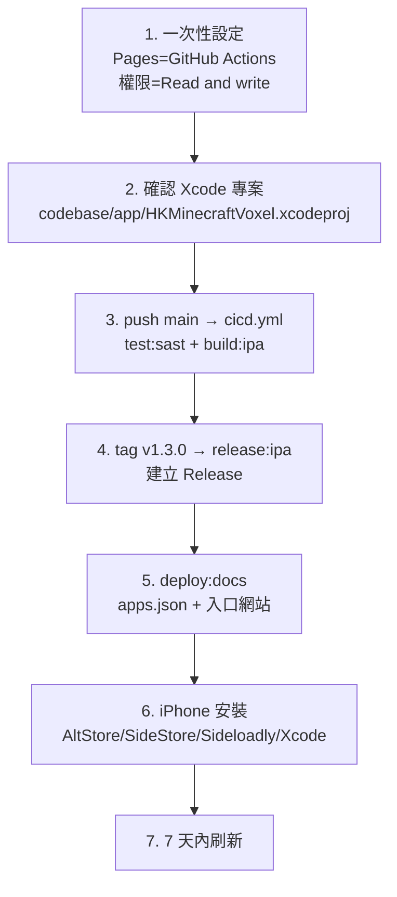

# 快速入門

5 分鐘從零到 iPhone 上 sideload。前提：repo 已 fork/clone 至本機，已安裝 Xcode + `gh`。



## 1. 一次性 repo 設定

在 GitHub `Mcc-Mak/ios-app` 設定兩項（只需一次）：

- **Settings → Pages → Source = GitHub Actions**
- **Settings → Actions → General → Workflow permissions = Read and write**

無需新增任何 secret；pipeline 僅用內建 `GITHUB_TOKEN`。

## 2. 確認 Xcode 專案

專案已在 `codebase/app/HKMinecraftVoxel.xcodeproj`。`build_unsigned_ipa.sh` 會以
`find -maxdepth 4` 自動探勘；請保持全 repo 僅一個 `.xcodeproj`，否則 fail fast。

## 3. 推到 main 觸發管線

```bash
git add .
git commit -m "feat: 更新 App"
git push origin main
```

`../.github/workflows/cicd.yml` 隨即執行 `test:sast`（模擬器測試 + 覆蓋率 + CodeQL），
通過後 `build:ipa` 建置未簽署 IPA，最後 `deploy:docs` 更新入口網站。到
**Actions → 該 run → Artifacts** 可下載 `unsigned-ipa`（暫時性，保留 30 天）。

## 4. 發行首版

```bash
git tag v0.1.0
git push origin v0.1.0
```

`test:sast` → `build:ipa` → `release:ipa`：建立 GitHub Release
（`--generate-notes --verify-tag`）並上傳 `.ipa` + `.dSYM.zip` + `manifest.json`。
接著 `deploy:docs` 重新產生 `apps.json` 並部署 Pages。

## 5. 在 iPhone 安裝

入口網站 <https://mcc-mak.github.io/ios-app/> 列出所有方式的完整步驟：

- **AltStore / SideStore**：加入來源 `https://mcc-mak.github.io/ios-app/apps.json`，即可看到 App 並安裝/刷新。
- **Sideloadly**：從 [最新發行版本](https://github.com/Mcc-Mak/ios-app/releases/latest)下載 `.ipa`，以免費 Apple ID 側載。
- **Xcode**：開啟專案，以 Personal Team 直接 Run 到裝置。

## 6. 7 天內刷新

免費 Apple ID sideload 憑證每 7 天過期。透過 AltStore/SideStore 饋流一鍵刷新，或重新
sideload 同一個 Release `.ipa`（URL 固定不變）。

---

完成後可參考 `setup.md`（本機開發）、`configurations.md`（設定）、`cicd.md`（job 細節）。