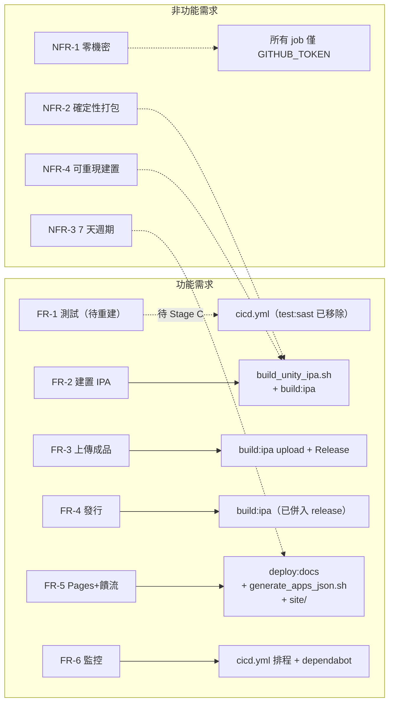

# 需求追溯矩陣 (RTM)

本矩陣將功能需求 (FR) 與非功能需求 (NFR) 對應到實作位置與驗證方式，確保每項需求皆被涵蓋且可驗證。

## 功能需求

| 需求ID | 需求說明 | 實作位置 | 驗證方式 |
|--------|---------|---------|---------|
| FR-1 | 模擬器測試 + 覆蓋率 | （待 Stage C GameCI 重建；`test:sast` 已移除） | 重建後：`xcodebuild test` 通過；`xcrun xccov view --report --json` 產生覆蓋率報告 |
| FR-2 | 建置未簽署 IPA | `../codebase/scripts/build_unity_ipa.sh`（`XCODEBUILD_ONLY=1`）+ `build:ipa` | IPA 產出；四個未簽署旗標齊備；`ditto` 保留符號連結；`unzip -l` 顯示 `Payload/<App>.app` 在 zip 根目錄 |
| FR-3 | 上傳建置成品 + 發行 | `build:ipa` upload-artifact + `gh release upload` 步驟 | Artifacts 含 `.ipa` + `.dSYM.zip` + `manifest.json`；Release 附掛同三資產 |
| FR-4 | 發行版本 | `../.github/workflows/cicd.yml`（`build:ipa`，已併入 `release:ipa`） | `workflow_dispatch` + `release_tag` 觸發；`gh release create --generate-notes --verify-tag` 產生 Release，asset 含 `.ipa`/`.dSYM.zip`/`manifest.json` |
| FR-5 | Pages 入口與 feed | `../.github/workflows/cicd.yml`（`deploy:docs`）+ `../codebase/scripts/generate_apps_json.sh` + `../codebase/site/` | https://mcc-mak.github.io/ios-app/ 部署成功；`apps.json` 可達且欄位完整 |
| FR-6 | 持續監控 | `../.github/workflows/cicd.yml`（每日排程）+ `../.github/dependabot.yml` | 每日 cron `deploy:docs` 通過；Dependabot 每週提交 `github-actions` 更新 PR |

## 非功能需求

| 需求ID | 需求說明 | 實作位置 | 驗證方式 |
|--------|---------|---------|---------|
| NFR-1 | 零 Apple 機密 | 所有 job 僅用 `GITHUB_TOKEN` | repo Settings → Secrets 無任何 Apple 憑證/profile/key；fork 後零設定即可運作（`build:ipa` 採預先匯出 Xcode 專案，CI 內不跑 Unity，故亦不需要 `UNITY_LICENSE`） |
| NFR-2 | 確定性打包 | `build_unity_ipa.sh`：`ditto` 複製 `.app` 保留符號連結，`cd` 到含 `Payload/` 的目錄再 `zip -r` | `unzip -l <App>-<Ver>.ipa` 列出 `Payload/<App>.app/...` 在 zip 根目錄；AltStore/Sideloadly 接受 |
| NFR-3 | 7 天憑證週期對應 | Release asset download URL + `apps.json` feed | `downloadURL` 指向 `https://github.com/Mcc-Mak/ios-app/releases/download/<tag>/<App>-<Ver>.ipa`；使用者可於 7 天內透過 feed 重新安裝/刷新 |
| NFR-4 | 可重現建置 | `build_unity_ipa.sh` 由 `Info.plist` 推導名稱/版本；scheme 自 `.xcscheme` 檔名偵測 | `<App>`/`<Ver>` 來自 `CFBundleShortVersionString`/`CFBundleIdentifier`；scheme 偵測優先讀 `Tuanjie-iPhone`/`Unity-iPhone` |

## 涵蓋摘要

- FR-2 ~ FR-6 皆有明確實作位置與驗證方式；FR-1 待 Stage C GameCI 重建。
- 無其他遺漏需求。

相關檔案：`../codebase/scripts/build_unity_ipa.sh`、`../codebase/scripts/export_xcode_project.ps1`、`../codebase/scripts/generate_apps_json.sh`、`../.github/workflows/`、`../codebase/site/`。
