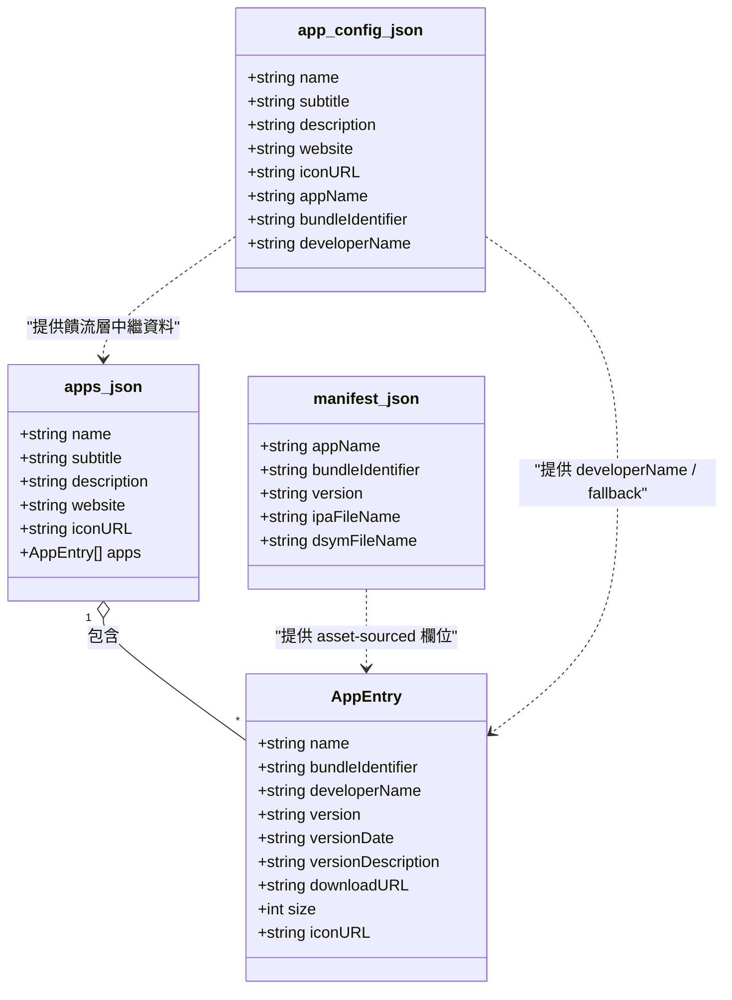

# 資料結構綱要

定義 ios-app 三份資料檔案的欄位結構：饋流 `apps.json`、建置中繼資料 `manifest.json`、饋流設定 `app.config.json`。所有檔案皆為 JSON、UTF-8 編碼。

> **核心規則：** `apps.json` App 層的 `version`、`versionDate`、`size`、`downloadURL` **必須 asset-sourced**（取自實際 Release 資產與 `manifest.json`），永不猜測。

## 1. apps.json（AltStore/SideStore 饋流）

產生者：`../codebase/scripts/generate_apps_json.sh`。端點：`https://mcc-mak.github.io/ios-app/apps.json`。

### 饋流層（Feed）

| 名稱 | 類型 | 必填 | 來源 | 說明 |
| --- | --- | --- | --- | --- |
| `name` | string | 是 | config | 來源名稱（`app.config.json` `name`）。 |
| `subtitle` | string | 否 | config | 副標題。 |
| `description` | string | 否 | config | 來源描述。 |
| `website` | string | 否 | config | 來源網站 URL。 |
| `iconURL` | string | 否 | config | 來源圖示 URL（可空字串）。 |
| `apps` | array | 是 | runtime | App 條目陣列；無發行版本時為 `[]`。 |

### App 條目（`apps[]`）

| 名稱 | 類型 | 必填 | 來源 | 說明 |
| --- | --- | --- | --- | --- |
| `name` | string | 是 | asset-sourced | App 名稱（`manifest.json` `appName`，fallback `app.config.json`）。 |
| `bundleIdentifier` | string | 是 | asset-sourced | Bundle ID（`manifest.json` `bundleIdentifier`，fallback config）。 |
| `developerName` | string | 是 | config | 開發者名稱（`app.config.json` `developerName`）。 |
| `version` | string | 是 | **asset-sourced** | 版本（`manifest.json` `version`；fallback 去除前導 `v` 的標籤）。 |
| `versionDate` | string | 是 | **asset-sourced** | 發行時間，ISO 8601（Release `publishedAt`）。 |
| `versionDescription` | string | 否 | asset-sourced | 發行說明（Release `body`）。 |
| `downloadURL` | string | 是 | **asset-sourced** | `https://github.com/<owner>/<repo>/releases/download/<tag>/<App>-<Ver>.ipa`。 |
| `size` | integer | 是 | **asset-sourced** | IPA 檔案位元組數（Release 資產 `size`）。 |
| `iconURL` | string | 否 | config | App 圖示 URL（沿用饋流層 `iconURL`）。 |

完整範例見 `./api.md`。無發行版本時輸出合法空饋流：`{ ..., "apps": [] }`。

## 2. manifest.json（建置中繼資料）

產生者：`../codebase/scripts/build_unsigned_ipa.sh`，作為 Release 資產上傳。

| 名稱 | 類型 | 必填 | 來源 | 說明 |
| --- | --- | --- | --- | --- |
| `appName` | string | 是 | asset-sourced | `Info.plist` `CFBundleName`。 |
| `bundleIdentifier` | string | 是 | asset-sourced | `Info.plist` `CFBundleIdentifier`。 |
| `version` | string | 是 | asset-sourced | `Info.plist` `CFBundleShortVersionString`。 |
| `ipaFileName` | string | 是 | runtime | `<appName>-<version>.ipa`。 |
| `dsymFileName` | string | 是 | runtime | `<appName>-<version>.dSYM.zip`。 |

## 3. app.config.json（饋流設定）

路徑：`../codebase/app.config.json`。由維護者編輯，提供饋流層中繼資料。

| 名稱 | 類型 | 必填 | 來源 | 說明 |
| --- | --- | --- | --- | --- |
| `name` | string | 是 | config | 饋流名稱。 |
| `subtitle` | string | 否 | config | 饋流副標題。 |
| `description` | string | 否 | config | 饋流描述。 |
| `website` | string | 否 | config | 饋流網站 URL。 |
| `iconURL` | string | 否 | config | 饋流圖示 URL（可空）。 |
| `appName` | string | 否 | config | App 名稱 fallback（當 manifest 缺漏時）。 |
| `bundleIdentifier` | string | 否 | config | Bundle ID fallback。 |
| `developerName` | string | 是 | config | 開發者名稱（寫入 App 條目）。 |

## 關聯文件

- 介面契約：`./api.md`　·　實體關係：`./erd.md`　·　決策：`./adr.md`（ADR-003）
