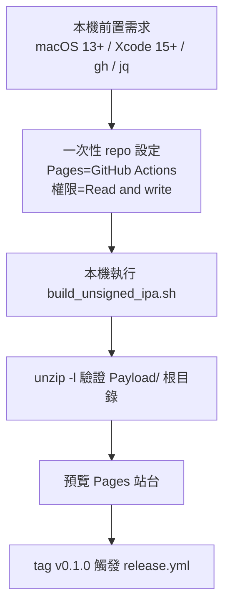

# 環境設定指南

本指南說明如何在本機準備開發環境、完成一次性 repo 設定，並執行首次發行。



## 本機開發前置需求

| 工具 | 最低版本 | 用途 |
|------|---------|------|
| macOS | 13+ | 執行 Xcode 與 xcodebuild |
| Xcode | 15+ | 建置 iOS app 與模擬器測試 |
| gh | 2.40+ | GitHub CLI，發行版本與查詢 Release asset |
| jq | 1.6+ | 解析 manifest.json / apps.json |

安裝方式：

```bash
# Xcode：從 Mac App Store 安裝
brew install gh jq
gh auth login
```

## 一次性 repo 設定

在 GitHub 上對 `Mcc-Mak/ios-app` 做兩項設定（只需一次）：

1. **Settings → Pages → Source = GitHub Actions**（不要選 branch）。Pages 才能由 `pages.yml` 部署到 https://mcc-mak.github.io/ios-app/。
2. **Settings → Actions → General → Workflow permissions = Read and write**。讓 `release.yml` 能建立 Release、`pages.yml` 能觸發部署。

此 pipeline 僅使用內建 `GITHUB_TOKEN`，無需新增任何 secret。

## Xcode 專案位置

Xcode 專案已存在於 `codebase/app/HKMinecraftVoxel.xcodeproj`（原生 Swift + SceneKit 體素 App，見 ADR-007）：

- `codebase/app/HKMinecraftVoxel.xcodeproj` — App + 單元測試 target
- `codebase/app/HKMinecraftVoxel/` — Swift 原始碼
- `codebase/app/HKMinecraftVoxelTests/` — 單元測試
- `codebase/scripts/build_unsigned_ipa.sh`
- `.github/workflows/`

`build_unsigned_ipa.sh` 以 `find -maxdepth 4` 自動探勘 `.xcodeproj` / `.xcworkspace` 與 scheme（根目錄或 `codebase/` 下皆可）；若同時找到超過一個專案會 **fail fast**，請保持僅有一個。若要替換為其他 App，將專案置於 `codebase/app/` 或根目錄即可。

## 在本機執行建置腳本

```bash
cd /path/to/ios-app
./codebase/scripts/build_unsigned_ipa.sh
```

輸出位置：

- `build/ipa/<App>-<Ver>.ipa`（以 `ditto` 保留符號連結；IPA 內 `Payload/<App>.app` 位於 zip 根目錄）
- `build/dsym/<App>-<Ver>.dSYM.zip`
- `build/ipa/manifest.json`（含 `appName`、`bundleIdentifier`、`version`、`ipaFileName`、`dsymFileName`）

驗證 IPA 結構：

```bash
unzip -l build/ipa/*.ipa | head
# 必須看到 Payload/<App>.app/... 在 zip 根目錄
```

可用的環境變數覆寫：`SCHEME`、`PROJECT`、`WORKSPACE`、`IPA_NAME`、`DSYM_NAME`、`CONFIGURATION`、`ARCHIVE_DIR`（詳見 `configurations.md`）。

## 在本機預覽 Pages 站台

`codebase/site/` 為純靜態檔案，用任何靜態伺服器即可預覽：

```bash
cd codebase/site
python3 -m http.server 8000
# 開啟 http://localhost:8000
```

## 首次發行

```bash
git tag v0.1.0
git push origin v0.1.0
```

推上 `v*` tag 後會觸發 `../.github/workflows/release.yml`：建置 IPA、建立 GitHub Release、上傳 `.ipa` + `.dSYM` + `manifest.json`，並觸發 `pages.yml` 重新產生 `apps.json`。

相關檔案：`../codebase/scripts/build_unsigned_ipa.sh`、`../codebase/scripts/generate_apps_json.sh`、`../.github/workflows/release.yml`、`../.github/workflows/pages.yml`。
