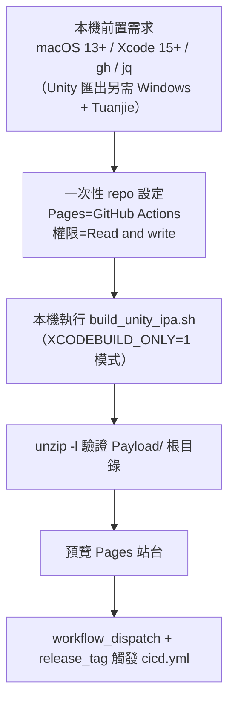

# 環境設定指南

本指南說明如何在本機準備開發環境、完成一次性 repo 設定，並執行首次發行。



## 本機開發前置需求

| 工具 | 最低版本 | 用途 |
|------|---------|------|
| macOS | 13+ | 執行 Xcode 與 xcodebuild |
| Xcode | 15+ | 建置 iOS app（`xcodebuild` 封存） |
| gh | 2.40+ | GitHub CLI，發行版本與查詢 Release asset |
| jq | 1.6+ | 解析 manifest.json / apps.json |

安裝方式：

```bash
# Xcode：從 Mac App Store 安裝
brew install gh jq
gh auth login
```

## 一次性 repo 設定

在 GitHub 上對 `Mcc-Mak/ios-app` 做兩項設定（只需一次）：

1. **Settings → Pages → Source = GitHub Actions**（不要選 branch）。Pages 才能由 `deploy:docs` 部署到 https://mcc-mak.github.io/ios-app/。
2. **Settings → Actions → General → Workflow permissions = Read and write**。讓 `build:ipa` 能建立/上傳 Release、`deploy:docs` 能部署 Pages。

此 pipeline 僅使用內建 `GITHUB_TOKEN`，無需新增任何 Apple 機密。`build:ipa` 採預先匯出 Xcode 專案模式，CI 內不跑 Unity，故亦不需要 `UNITY_LICENSE` secret。

## Unity 專案位置

Unity 專案（Tuanjie 2022.3.61t15 + C# + glTFast）位於 `codebase/unity-project/`（見 `./adr.md` ADR-009 / ADR-011）：

- `codebase/unity-project/` — Tuanjie 專案（`Assets/Scripts/` 為 Stage B 串流腳本、`Assets/StreamingAssets/Chunks/` 為分塊資料，gitignored）
- `codebase/converter/` — Stage A Python 轉換器（OSGB → 分塊 GLB）
- `codebase/scripts/build_unity_ipa.sh` — 建置腳本（三模式）
- `codebase/scripts/export_xcode_project.ps1` — 本機 Windows 以 Tuanjie 匯出 Xcode 專案（`-ChunksSource` 注入分塊）
- `.github/workflows/`

`build_unity_ipa.sh` 自 `XCODE_PROJECT_DIR` 指定的 Xcode 專案執行 `xcodebuild`；scheme 偵測優先讀 `.xcscheme` 檔名（Tuanjie 匯出 `Tuanjie-iPhone`、Unity 匯出 `Unity-iPhone`），fallback 至 `xcodebuild -list`，最後 fallback 至 `.xcodeproj` basename。

## 在本機執行建置腳本

`build_unity_ipa.sh` 有三種互斥模式：

- **預設**：完整管線（Unity export + `xcodebuild` + 打包），需本機有 Unity/Tuanjie。
- `UNITY_EXPORT_ONLY=1`：僅 Unity 匯出 Xcode 專案（Windows 本機用）。
- `XCODEBUILD_ONLY=1`：僅 `xcodebuild` + 打包（CI macOS 用，需 `XCODE_PROJECT_DIR`）。

本機 macOS 驗證封存（需先有 Xcode 專案，例如經 `export_xcode_project.ps1` 匯出後下載）：

```bash
cd /path/to/ios-app
XCODE_PROJECT_DIR=/path/to/exported-xcode XCODEBUILD_ONLY=1 ./codebase/scripts/build_unity_ipa.sh
```

輸出位置：

- `build/ipa/<App>-<Ver>.ipa`（以 `ditto` 保留符號連結；IPA 內 `Payload/<App>.app` 位於 zip 根目錄）
- `build/dsym/<App>-<Ver>.dSYM.zip`
- `build/ipa/manifest.json`（含 `appName`、`bundleIdentifier`、`version`、`ipaFileName`、`dsymFileName`、`ipaSizeBytes`、`minIOSVersion`）

驗證 IPA 結構：

```bash
unzip -l build/ipa/*.ipa | head
# 必須看到 Payload/<App>.app/... 在 zip 根目錄
```

可用的環境變數覆寫：`SCHEME`、`PROJECT`、`WORKSPACE`、`XCODE_PROJECT_DIR`、`IPA_NAME`、`DSYM_NAME`、`CONFIGURATION`、`ARCHIVE_DIR`、`UNITY_EXPORT_ONLY`、`XCODEBUILD_ONLY`（詳見 `configurations.md`）。

## 在本機預覽 Pages 站台

`codebase/site/` 為純靜態檔案，用任何靜態伺服器即可預覽：

```bash
cd codebase/site
python3 -m http.server 8000
# 開啟 http://localhost:8000
```

## 首次發行

發行經 `workflow_dispatch` 觸發（指定 `release_tag`，semver `v*`）：

1. 先以本機 Windows + Tuanjie 匯出 Xcode 專案（`export_xcode_project.ps1 -ChunksSource <dir>`），打包上傳至 `xcode-export-*` Release。
2. 於 GitHub Actions → `cicd.yml` → **Run workflow**，輸入 `release_tag`（如 `v2.2.18`）。

`build:ipa` 會下載預先匯出的 Xcode 專案、以 `XCODEBUILD_ONLY=1` 模式執行 `build_unity_ipa.sh` 進行未簽署封存，建立/更新目標 Release 並上傳 `.ipa` + `.dSYM.zip` + `manifest.json`，最後 `deploy:docs`（`needs: build` + `if: always()`）重新產生 `apps.json` 並部署入口網站。

相關檔案：`../codebase/scripts/build_unity_ipa.sh`、`../codebase/scripts/export_xcode_project.ps1`、`../codebase/scripts/generate_apps_json.sh`、`../.github/workflows/cicd.yml`。
