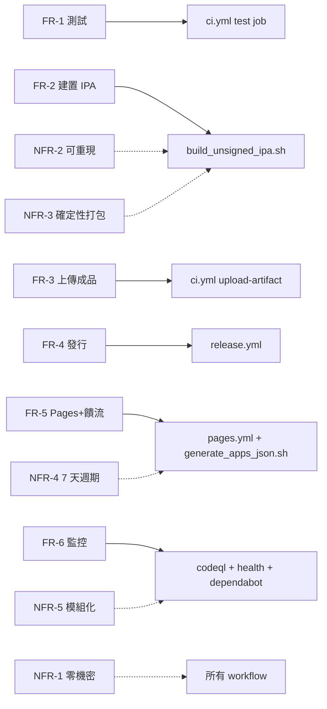

# 軟體需求規格（SRS）

本文件將六個 pipeline 階段對應至功能性需求（FR）與非功能性需求（NFR）。硬性限制見 `../AGENTS.md`。

## 功能性需求

| 編號 | 階段 | 需求描述 | 實作 |
| --- | --- | --- | --- |
| FR-1 | 測試 | 於 iOS Simulator 執行未簽署測試，啟用覆蓋率並匯出報告。 | `../.github/workflows/ci.yml` |
| FR-2 | 建置未簽署 IPA | 以 Release 封存，打包為 `Payload/<App>.app` 位於 zip 根目錄的 IPA，並產生 dSYM.zip。 | `../codebase/scripts/build_unsigned_ipa.sh` |
| FR-3 | 上傳成品 | 將 IPA / dSYM / manifest.json 上傳為 workflow artifact。 | `../.github/workflows/ci.yml` |
| FR-4 | 發行版本 | `v*` tag 觸發，建立 GitHub Release 並附掛 `.ipa` + `.dSYM.zip` + `manifest.json`。 | `../.github/workflows/release.yml` |
| FR-5 | Pages 入口與饋流 | 建置站台、由最新 Release 重建 `apps.json`、部署至 GitHub Pages。 | `../.github/workflows/pages.yml`、`../codebase/scripts/generate_apps_json.sh` |
| FR-6 | 監控與相依性更新 | 每日 cron 未簽署建置檢查；Dependabot 週更 `swift` + `github-actions`。 | `../.github/workflows/health.yml`、`../.github/dependabot.yml` |

### FR 細節

- **FR-1**：目的地僅限 simulator（如 `platform=iOS Simulator,name=iPhone 15,OS=latest`）；覆蓋率經 `xcrun xccov view --report --json` 匯出。
- **FR-2**：每次 `xcodebuild` 帶四個未簽署旗標：`CODE_SIGNING_ALLOWED=NO CODE_SIGNING_REQUIRED=NO CODE_SIGN_IDENTITY="" CODE_SIGN_ENTITLEMENTS=""`。App 名稱與版本取自 built `Info.plist`（`CFBundleName` / `CFBundleShortVersionString`），不寫死；以 `ditto` 取出 `<App>.app`（保留符號連結/中介資料），產出 `manifest.json` 並寫入 `GITHUB_OUTPUT` 鍵。
- **FR-5**：資產來源欄位（`version`、`versionDate` ISO-8601、`size` bytes、`downloadURL`）來自實際 Release asset + `manifest.json`，而非猜測。

## 非功能性需求

| 編號 | 需求 | 說明 |
| --- | --- | --- |
| NFR-1 | 零 Apple 機密 | 僅使用 `GITHUB_TOKEN`；禁止 certs、profiles、fastlane match、App Store Connect keys。fork 零 secret 即可運作。 |
| NFR-2 | 可重現建置 | 僅 `macos-latest` runner；以 `maxim-lobanov/setup-xcode` 明確選定 Xcode，不信賴 runner 預設。 |
| NFR-3 | 確定性打包 | IPA 佈局須為 `Payload/<App>.app` 於 zip 根目錄；`cd` 到含 `Payload/` 的目錄再 `zip -r`；以 `unzip -l` 驗證。 |
| NFR-4 | 7 天憑證週期支援 | Releases + AltStore/SideStore 饋流讓使用者重新安裝/刷新，無需手動重新側載；不內嵌任何長效簽署假設。 |
| NFR-5 | 模組化 workflow | 一個 workflow 一個職責（ci / release / pages / codeql / health）。 |
