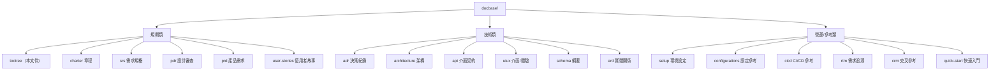

# 文件目錄與導覽

本目錄（`docbase/`）收錄 ios-app 專案的所有文件。內容以繁體中文撰寫，技術專有名詞保留英文。路徑皆相對於 `docbase/`。

## docbase 文件

| 文件 | 說明 | 路徑 |
| --- | --- | --- |
| toctree | 文件目錄與導覽中樞（本文件）。 | `./toctree.md` |
| charter | 專案章程：目的、範圍、目標、成功標準、關係人、時間表。 | `./charter.md` |
| srs | 軟體需求規格：將六個 pipeline 階段對應至功能性與非功能性需求。 | `./srs.md` |
| pdr | 初步設計審查：關鍵設計決策、理由、取捨與被否決的替代方案。 | `./pdr.md` |
| prd | 產品需求文件：以「側載發行系統」為產品，定義角色與功能驗收標準。 | `./prd.md` |
| user-stories | 使用者故事：依角色分組，附驗收條件。 | `./user-stories.md` |
| adr | 架構決策紀錄（Architecture Decision Records）。 | `./adr.md` |
| architecture | 系統架構總覽與元件互動。 | `./architecture.md` |
| api | 自動化腳本與產出物（manifest.json、apps.json）的介面說明。 | `./api.md` |
| uiux | Pages 入口網站的介面與體驗設計。 | `./uiux.md` |
| schema | apps.json 與 manifest.json 的欄位結構定義。 | `./schema.md` |
| erd | 資料模型關係（發行、成品、饋流之間的關聯）。 | `./erd.md` |
| setup | 本機開發與前置作業說明。 | `./setup.md` |
| configurations | 建置設定、Xcode scheme、SwiftLint、Dependabot 等組態。 | `./configurations.md` |
| cicd | CI/CD pipeline 各 workflow 的流程與觸發條件詳解。 | `./cicd.md` |
| rtm | 需求追溯矩陣（Requirements Traceability Matrix）。 | `./rtm.md` |
| crm | 交叉參考矩陣（Cross-Reference Matrix）：文件與需求/實作間的對應。 | `./crm.md` |
| quick-start | 快速上手：從 clone 到觸發首次發行的最短路徑。 | `./quick-start.md` |

## 根目錄文件

| 文件 | 說明 | 路徑 |
| --- | --- | --- |
| AGENTS.md | 給 OpenCode agent 的硬性限制與規範（先讀再動 CI/CD）。 | `../AGENTS.md` |
| README.md | 專案簡介與側載教學（單一來源）。 | `../README.md` |
| CHANGELOG.md | semver 版本變更紀錄（`vX.X.X`）。 | `../CHANGELOG.md` |

## 關鍵實作路徑

- 建置腳本：`../codebase/scripts/build_unsigned_ipa.sh`
- 饋流產生：`../codebase/scripts/generate_apps_json.sh`
- CI workflow：`../.github/workflows/ci.yml`
- 發行 workflow：`../.github/workflows/release.yml`
- Pages workflow：`../.github/workflows/pages.yml`
