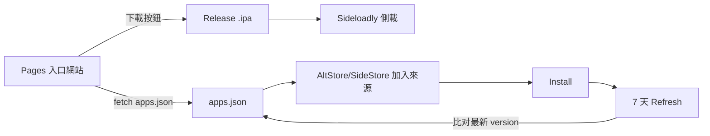
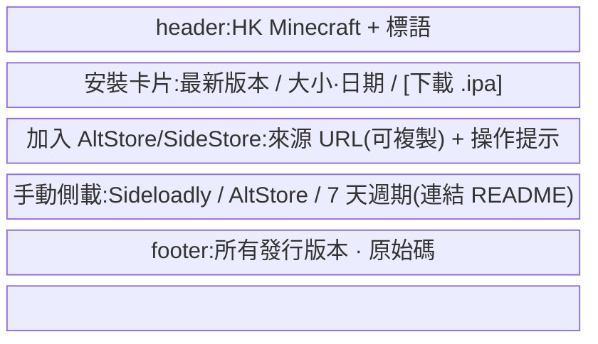

# UI/UX 設計

ios-app 有兩個使用者介面：（a）**GitHub Pages 入口網站**（靜態站台，供側載使用者取得 IPA 與來源 URL）；（b）**AltStore/SideStore 安裝流程**（使用者加入來源後的 App 安裝與刷新體驗）。兩者皆以繁體中文呈現。

## (a) GitHub Pages 入口網站

檔案：`../codebase/site/index.html` + `style.css`。無後端；client-side `fetch('apps.json')` 渲染最新版本。

### 版面

### 設計要點

- **深色主題（dark theme）**，響應式（`viewport` meta）。
- **最新版本卡片**：從 `apps.json` 的 `apps[0]` 取 `version`、`downloadURL`、`size`、`versionDate`；無發行版本時顯示「尚無」並停用按鈕。
- **下載按鈕**：直接連到 `downloadURL`（公開 Release 資產）。
- **來源 URL 區區塊**：顯示 `apps.json` 端點，供使用者複製貼入 AltStore/SideStore。
- **手動側載連結**：指向 `README.md` 錨點（側載步驟單一來源，站台不重複內容）。
- **無後端**：純靜態，部署於 GitHub Pages；`fetch` 失敗時降級級顯示「饋流無法取得」。

## (b) AltStore / SideStore 安裝流程 UX

使用者透過 AltStore/SideStore 加入來源後的體驗。

### 安裝步驟

1. 於 AltStore/SideStore：**設定 → 來源 → 點擊「+」**。
2. 貼入來源 URL：`https://mcc-mak.github.io/ios-app/apps.json`。
3. 來源載入後，來源清單顯示本 App（名稱、開發者、圖示）。
4. 點選 App → **Install（安裝）**。
5. AltStore/SideStore 以使用者免費 Apple ID 現場簽署並安裝；首次需輸入 Apple ID。
6. 安裝完成後 App 出現於主畫面。

### 7 天憑證刷新週期

- 免費 Apple ID 側載憑證**每 7 天過期**；過期後 App 無法啟動。
- 重新整理方式：開啟 AltStore/SideStore →於 App 列表點 **Refresh（重新整理）**，或在同一 Wi-Fi 下讓 AltStore/SideStore 自動刷新。
- 透過來源安裝者，刷新會自動比對 `apps.json` 最新 `version`；有新版時可一鍵更新。
- 詳見 `../README.md`「7 天免費 Apple ID 憑證更新週期」章節。

### 免費 Apple ID 限制（需告知使用者）

| 限制 | 上限 |
| --- | --- |
| 每台裝置可安裝的側載 App 數 | **3 個** |
| 每個免費 Apple ID 每 7 天可註冊的 App ID 數 | **10 個** |
| 側載憑證效期 | **7 天** |

> 超過上述限制時，AltStore/SideStore 會回報簽署失敗；使用者需移除既有側載 App 騰出配額，或等待 7 天週期重置。

## 關聯文件

- 站台原始碼：`../codebase/site/index.html`　·　饋流契約：`./api.md`　·　欄位綱要：`./schema.md`
- 側載步驟單一來源：`../README.md`
