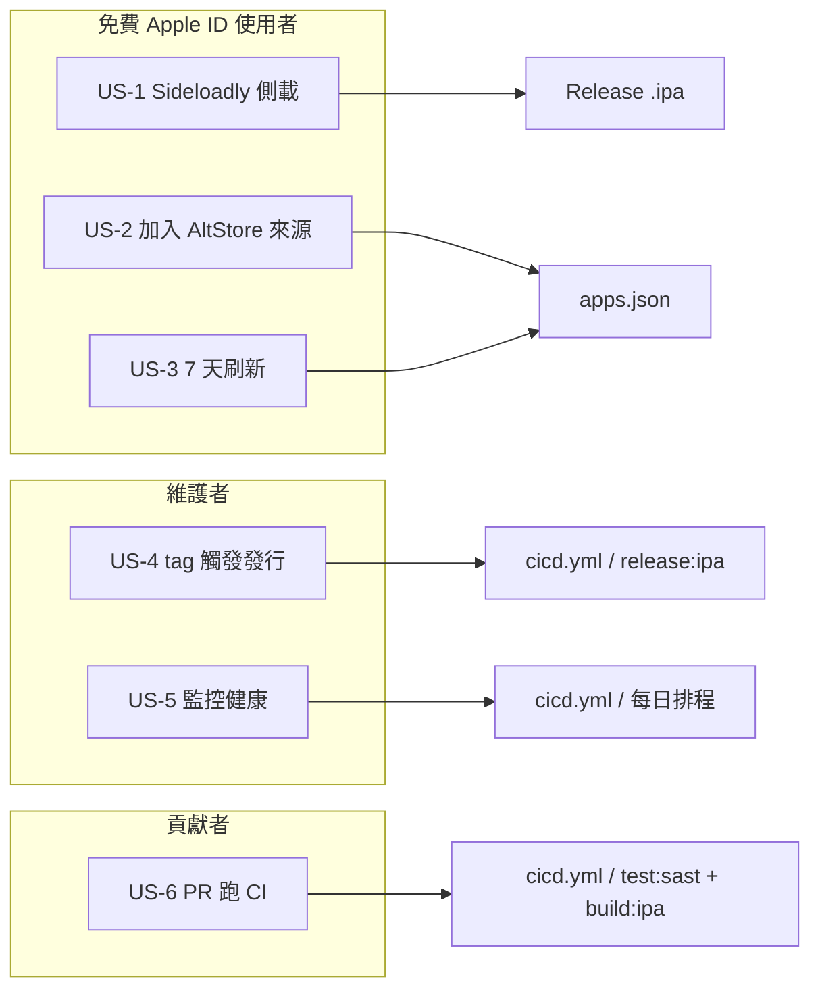

# 使用者故事

格式：作為<角色>，我想要<功能>，以便<價值>。每則故事附驗收條件。硬性限制見 `../AGENTS.md`。

## 角色：免費 Apple ID 使用者

### US-1：以 Sideloadly 側載安裝
作為免費 Apple ID 使用者，我想要從 GitHub Release 下載 `.ipa` 並以 Sideloadly 側載，以便在無付費帳號下安裝 App。
- **驗收條件**：Release 含 `.ipa`；`unzip -l` 顯示 `Payload/<App>.app` 於 zip 根目錄；Sideloadly 可成功安裝。

### US-2：加入 AltStore/SideStore 來源
作為免費 Apple ID 使用者，我想要將 `apps.json` 加入 AltStore/SideStore，以便自動接收後續更新。
- **驗收條件**：`https://mcc-mak.github.io/ios-app/apps.json` 有效且符合 schema；加入來源後可看見 App 並安裝。

### US-3：7 天憑證自動刷新
作為免費 Apple ID 使用者，我想要在 7 天憑證到期前透過 AltStore/SideStore 刷新，以便 App 持續可用。
- **驗收條件**：饋流 `versionDate` 隨每次發行更新；AltStore/SideStore 可重新整理安裝最新版。

## 角色：維護者

### US-4：以 tag 觸發發行
作為維護者，我想要推送 `v*` semver tag 自動建置並發行，以便無手動步驟地交付新版。
- **驗收條件**：`../.github/workflows/cicd.yml` 的 `release:ipa` 建立 Release，附掛 `.ipa` + `.dSYM.zip` + `manifest.json`；同一次執行的 `deploy:docs` 重建饋流。

### US-5：監控 pipeline 健康
作為維護者，我想要每日自動建置檢查，以便及早發現 runner/Xcode 漂移。
- **驗收條件**：`../.github/workflows/cicd.yml` 的每日排程於 `main` 執行 `test:sast` → `build:ipa`；失敗時通知。

## 角色：貢獻者

### US-6：在 PR 上跑 CI
作為貢獻者，我想要對 PR 自動執行測試與未簽署建置，以便在合併前驗證變更。
- **驗收條件**：`../.github/workflows/cicd.yml` 於 PR 到 `main` 觸發 `test:sast` → `build:ipa`；回報測試結果、覆蓋率與 IPA artifact。
